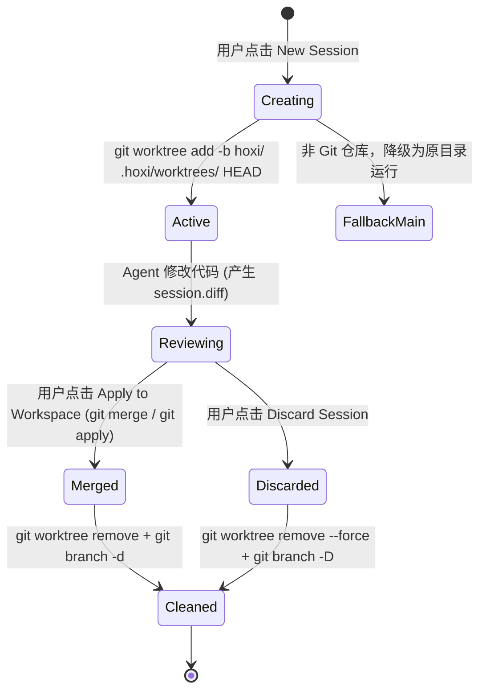

# hoxi 开发者全景与工程实现手册 (DEVELOPMENT.md)

本文档是 `hoxi` 的**生产级工程实现规范（Implementation-Ready Blueprint）**。文档中的所有接口路径、SSE 事件载荷、插件 Hook 签名、Git Worktree 状态机及 Wails/CGo 原生宿主代码均已对齐 **OpenCode `v1.18+` 真实 OpenAPI 规范**、**`gopanel_v2` 桌面宿主实现**、**三栏工作区架构** 以及 **`Kilo Code` SolidJS 任务执行引擎**，可直接作为开发与验收的唯一事实来源（Single Source of Truth）。

---

## 目录

1. [架构全景与设计哲学](#1-架构全景与设计哲学)
2. [技术栈选型与职责边界](#2-技术栈选型与职责边界)
3. [Go 守护进程与零端口内存网关规范](#3-go-守护进程与零端口内存网关规范)
   - [3.1 OpenCode 子进程守护与冷启动优化](#31-opencode-子进程守护与冷启动优化)
   - [3.2 HTTP Basic Auth 注入与本地代理防劫持](#32-http-basic-auth-注入与本地代理防劫持)
   - [3.3 SSE 零缓冲流式转发与 WebSocket 终端升级](#33-sse-零缓冲流式转发与-websocket-终端升级)
4. [OpenCode 核心 REST API 与通信契约 (v1.18+ 实测)](#4-opencode-核心-rest-api-与通信契约-v118-实测)
   - [4.1 核心端点速查表](#41-核心端点速查表)
   - [4.2 发送异步 Prompt 与模式/模型切换](#42-发送异步-prompt-与模式模型切换)
   - [4.3 权限审批与追问回复契约](#43-权限审批与追问回复契约)
   - [4.4 内置 PTY 终端与 WebSocket 协议](#44-内置-pty-终端与-websocket-协议)
5. [SSE `/event` 实时事件流与前端状态机](#5-sse-event-实时事件流与前端状态机)
   - [5.1 真实 SSE 事件类型与 TypeScript 定义](#51-真实-sse-事件类型与-typescript-定义)
   - [5.2 120Hz `requestAnimationFrame` 流式批处理引擎](#52-120hz-requestanimationframe-流式批处理引擎)
6. [前端 UI 架构：三栏工作区外壳 + Kilo 任务流](#6-前端-ui-架构三栏工作区外壳--kilo-任务流)
   - [6.1 视觉 Token 与低饱和暗黑规范](#61-视觉-token-与低饱和暗黑规范)
   - [6.2 三栏工作区布局 (`ThreePaneShell`)](#62-三栏工作区布局-threepaneshell)
   - [6.3 Kilo Code 风格动态工具卡片 (`ToolCard`)](#63-kilo-code-风格动态工具卡片-toolcard)
   - [6.4 独立推理抽屉 (`ThoughtBox`) 与内联审批门控 (`ApprovalGateCard`)](#64-独立推理抽屉-thoughtbox-与内联审批门控-approvalgatecard)
   - [6.5 Pierre Diff 审查器与 WebGL Xterm 终端集成](#65-pierre-diff-审查器与-webgl-xterm-终端集成)
   - [6.6 三大高阶控制能力](#66-三大高阶控制能力)
7. [Git Worktree 物理会话隔离与合并生命周期](#7-git-worktree-物理会话隔离与合并生命周期)
   - [7.1 Worktree 沙箱状态机](#71-worktree-沙箱状态机)
   - [7.2 Go Worktree 管理器接口契约 (`internal/worktree/`)](#72-go-worktree-管理器接口契约-internalworktree)
8. [OpenCode 插件体系：安全门控与 8 维记忆沉淀](#8-opencode-插件体系安全门控与-8-维记忆沉淀)
   - [8.1 真实 `@opencode-ai/plugin` Hook 签名](#81-真实-opencode-aiplugin-hook-签名)
   - [8.2 权限智能分流插件 (`hoxi-permissions.js`)](#82-权限智能分流插件-hoxi-permissionsjs)
   - [8.3 8 维度结构化记忆插件 (`hoxi-memory.js`)](#83-8-维度结构化记忆插件-hoxi-memoryjs)
9. [macOS 原生宿主与状态栏托盘 (`internal/app/` & `internal/statusbar/`)](#9-macos-原生宿主与状态栏托盘-internalapp--internalstatusbar)
   - [9.1 Wails 窗口配置与单实例锁](#91-wails-窗口配置与单实例锁)
   - [9.2 Objective-C `NSStatusBar` 状态机联动](#92-objective-c-nsstatusbar-状态机联动)
10. [多运行时执行引擎与跨软件会话接管 (`internal/runner/` & `internal/handoff/`)](#10-多运行时执行引擎与跨软件会话接管-internalrunner--internalhandoff)
11. [移动端「沟通即操作系统」与全双工实时语音架构 (`client/`)](#11-移动端沟通即操作系统与全双工实时语音架构-client)

---

专项设计文档：[Skills 开发规范与实施方案](docs/skills-development.md)（待实现设计，包含标准 `SKILL.md`、统一接口、运行时适配与验收要求）。

## 1. 架构全景与设计哲学

`hoxi` 的核心定位是：**专为全功能 AI Agent 打造的高颜值、轻量化、原生质感桌面工作台**。项目通过四层解耦架构，将核心工程能力融为一体（完整目录树与模块归属决策表以 [`AGENTS.md`](AGENTS.md) 为唯一权威来源）：

```text
┌────────────────────────────────────────────────────────────────────────┐
│ 1. 原生宿主层 (Desktop Host: internal/app & internal/statusbar)        │
│    - Wails v2 + WKWebView (0.2s 极速冷启动, 约 30MB 内存占用)            │
│    - macOS 原生毛玻璃背景 (Vibrancy) + 沉浸式无边框交通灯标题栏         │
│    - Objective-C 状态栏常驻图标 (Running 忙碌计数 / Attention 待审批)   │
│    - 单实例运行锁 (SingleInstanceLock) + 点红叉仅隐藏窗口后台常驻       │
├────────────────────────────────────────────────────────────────────────┤
│ 2. 前端工作区 (Frontend UI: web/src/{components,store,services,i18n})  │
│    - 外壳布局：经典三栏 (左侧项目/工作树 + 中间对话 + 右侧审查)          │
│    - 任务交互：Kilo Code 动态工具卡片、独立 Reasoning 抽屉、内联审批门控│
│    - 核心引擎：Vite + SolidJS + Tailwind CSS (零 VDOM，120Hz 满帧流式)  │
│    - 审查与终端：@pierre/diffs Hunk 级代码对比 + @xterm/addon-webgl     │
├────────────────────────────────────────────────────────────────────────┤
│ 3. Go 模块化守护与安全网关 (internal/{gateway,worktree,provider,...})  │
│    - 子进程守护 (internal/opencode)：全生命周期监管原版 `opencode serve`│
│    - 零端口内存网关 (internal/gateway)：进程内反向代理 + 会话目录隔离守卫│
│    - Basic Auth 随机密码注入 + 绕过系统 HTTP_PROXY 防止本地 502         │
│    - Git Worktree 沙箱引擎 (internal/worktree)：`.hoxi/worktrees/<id>`  │
├────────────────────────────────────────────────────────────────────────┤
│ 4. 多运行时 Agent 内核 (internal/opencode & internal/runner)           │
│    - 官方 pristine `opencode` 二进制（Upstream Zero-Fork 零侵入）        │
│    - 多运行时引擎 (internal/runner)：原生驱动 Claude Code / agy / Qoder │
│    - 本地插件：.opencode/plugins/ (安全命令免批 + 8 维度结构化记忆沉淀) │
└────────────────────────────────────────────────────────────────────────┘
```

### 核心铁律：Upstream Zero-Fork（上游零侵入）
**严禁 Fork 或修改 OpenCode 源码**。`opencode` 仅作为被 Go 监管的外部子进程运行。上游新增模型适配（Claude / GPT / Gemini / DeepSeek / 本地 Ollama）或升级工具链时，直接升级系统的 `opencode` 二进制即可。

---

## 2. 技术栈选型与职责边界

| 层级 | 技术栈与核心依赖 | 借鉴定点与选型依据 |
| :--- | :--- | :--- |
| **桌面宿主** | Go `>= 1.23` + Wails `v2.13+` + CGo (Cocoa) | 模块化收归于 `internal/app` 与 `internal/statusbar`（含 `statusbar_darwin.m`）。 |
| **前端视图层** | SolidJS `^1.9` + TypeScript `^5.7` + Vite `^6.0` | 与 `Kilo Code` (`packages/kilo-ui`) 同源技术栈；细粒度 Signal 响应式直接操作真实 DOM，流式渲染零虚拟 DOM 开销。 |
| **样式系统** | Tailwind CSS `^4.0` + CSS Variables | 深邃暗黑极简调性（`#0b0d12` 底色 + `1px` 微光边框 + 等宽数值对齐）。 |
| **代码 Diff** | `@pierre/diffs` | 渲染 OpenCode 返回的 `SnapshotFileDiff` / Unified Patch，支持 Inline 与 Side-by-Side 切换。 |
| **终端组件** | `@xterm/xterm` + `@xterm/addon-webgl` + `@xterm/addon-fit` | 直连 OpenCode 内置的 `/pty/{ptyID}/connect` WebSocket 终端流，支持 GPU 加速与窗口自适应。 |
| **Agent 内核** | `opencode serve` (`>= v1.18.0`) + `internal/runner` | 提供 `/session`、`/event`、`/permission`、`/pty`、`/vcs`、`/file` 及多运行时适配能力。 |

---

## 3. Go 守护进程与零端口内存网关规范

### 3.1 OpenCode 子进程守护与冷启动优化
Go 启动时（[`internal/opencode/`](internal/opencode/)）查找 `HOXI_OPENCODE` 环境变量或系统 `PATH` 中的 `opencode`，分配空闲本地回环端口（如 `127.0.0.1:41xxx`），并以如下参数启动：

```bash
opencode serve --hostname 127.0.0.1 --port <free-port> --print-logs
```

**关键环境变量注入（必配）**：
1. `OPENCODE_SERVER_PASSWORD=<32-byte-random-hex>`：由 Go `crypto/rand` 在每次启动时生成，绝不落盘。
2. `OPENCODE_SERVER_USERNAME=opencode`：显式固定认证用户名。
3. `OPENCODE_DISABLE_CONFIG_DEPENDENCY_INSTALL=1`：**极其重要**！OpenCode 默认在检测到 `.opencode/` 目录时会调用 `bun add @opencode-ai/plugin` 联网安装依赖，在国内网络或代理异常时会导致冷启动卡死超时。设置该变量（或在 `.opencode/` 预置好静态依赖）可将冷启动耗时控制在 **200ms** 以内。
4. `NO_PROXY=127.0.0.1,localhost`：防止子进程内部回环请求被系统代理拦截。

**就绪探针与引擎状态路径（Health Check & Engine Paths）**：
- 引擎数据库（`hoxi.db`）与数据/状态目录（`engine-data`、`engine-state`）统一由底座包 [`internal/hoxipaths`](internal/hoxipaths/hoxipaths.go) 解析；本机 OpenCode Console 账号预同步由 [`internal/opencode/ocstate`](internal/opencode/ocstate/ocstate.go) 统一处理。
- Go 启动子进程后，通过 [`internal/opencode/ocapi`](internal/opencode/ocapi/client.go) 以 100ms 间隔轮询 `GET http://127.0.0.1:<port>/global/health`（携带 Basic Auth），当返回 `200 OK` 且 `{"healthy": true}` 时标记网关就绪。

### 3.2 HTTP Basic Auth 注入与本地代理防劫持
> [!IMPORTANT]
> **避坑指南（实测验证）**：
> 1. `opencode serve` 在设置 `OPENCODE_SERVER_PASSWORD` 后，使用的是 **HTTP Basic Auth**（`WWW-Authenticate: Basic realm="Secure Area"`），**不是** `Bearer` Token！若注入 `Bearer` 会直接收到 `401 Unauthorized`。
> 2. macOS 开发者常开启 Clash / Surge 等系统代理（设置 `HTTP_PROXY` 环境变量）。Go 的 `http.DefaultTransport` 默认会读取环境代理，导致发往 `127.0.0.1:<port>` 的反向代理请求被转发给外部代理并返回 `502 Bad Gateway`。因此反向代理及所有直连引擎的客户端 **必须复用 [`internal/opencode/ocapi`](internal/opencode/ocapi/client.go) 的共享 `Transport`（显式设置 `Proxy: nil`）**。

[`internal/gateway/gateway.go`](internal/gateway/gateway.go) 与 [`internal/opencode/ocapi/client.go`](internal/opencode/ocapi/client.go) 标准实现模型：

```go
func newOpenCodeReverseProxy(target *url.URL, openCode *ocapi.Client) *httputil.ReverseProxy {
	proxy := httputil.NewSingleHostReverseProxy(target)
	// 1. 复用 ocapi 共享回环 Transport（Proxy: nil），忽略系统 HTTP_PROXY / HTTPS_PROXY，彻底杜绝 502 Bad Gateway
	proxy.Transport = ocapi.Transport()
	// 2. SSE 实时流必须设置 FlushInterval = -1，禁用响应缓冲，收到字节立即推送给前端
	proxy.FlushInterval = -1

	origDirector := proxy.Director
	proxy.Director = func(req *http.Request) {
		origDirector(req)
		req.Host = target.Host
		// 3. 统一由 ocapi 注入 OpenCode 要求的 HTTP Basic Auth (username: "opencode")
		openCode.Authorize(req)
	}
	return proxy
}
```

### 3.3 SSE 零缓冲流式转发与 WebSocket 终端升级
1. **静态资源与 API 分流（`internal/gateway/gateway.go`）**：
   - 当请求路径匹配 `/session`、`/event`、`/global`、`/permission`、`/question`、`/pty`、`/vcs`、`/file`、`/find`、`/provider`、`/config`、`/command`、`/agent`、`/lsp`、`/experimental`、`/api/hoxi/` 时，交由 Go 网关处理或反向代理至 `opencode serve`。
   - 其余路径回退给 `web/dist` 前端静态资源（SPA History 路由回退至 `index.html`）。
2. **WebSocket 终端连接限制与方案**：
   - Wails 的 `AssetServer.Handler` 基于自定义 `wails://` Scheme 拦截 HTTP 请求，**原生不支持在 `wails://` 上直接 Upgrade WebSocket**（见 `gopanel_v2/desktop_gateway.go` 注释）。
   - **标准解决方案**：Go 网关同时在 `127.0.0.1:<gateway-port>` 开启一个仅绑定本地回环的轻量级 HTTP/WS 监听器（携带一次性启动 Nonce 校验），并通过 `/api/hoxi/bootstrap` 接口将该 `ws://127.0.0.1:<gateway-port>` 地址下发给前端。前端 Xterm 组件通过该本地地址建立 `/pty/{ptyID}/connect` WebSocket 连接，Go 网关自动完成 Basic Auth 注入与双向字节流透传。

---

## 4. OpenCode 核心 REST API 与通信契约 (v1.18+ 实测)

所有发往 OpenCode 的请求均支持通过 Query 参数 `?directory=<urlencoded-worktree-path>` 指定该次操作所属的工作目录（即会话对应的 Git Worktree 沙箱路径）。

### 4.1 核心端点速查表

| 功能模块 | HTTP 方法与路径 | Query 参数 | 请求体 (Request Body) | 响应说明 |
| :--- | :--- | :--- | :--- | :--- |
| **健康检查** | `GET /global/health` | 无 | 无 | `{"healthy": true, "version": "1.18.25"}` |
| **全局事件流** | `GET /event` | `?directory=` | 无 (SSE `text/event-stream`) | 实时推送当前工作区的所有 `Event` |
| **会话列表** | `GET /session` | `?directory=&limit=50` | 无 | 返回 `Session[]` 列表 |
| **创建会话** | `POST /session` | `?directory=` | `{"title"?: string, "agent"?: string}` | 返回新建的 `Session` 对象 (`id: "ses_..."`) |
| **更新会话** | `PATCH /session/{sessionID}` | `?directory=` | `{"title": string}` | 重命名会话标题 |
| **删除会话** | `DELETE /session/{sessionID}` | `?directory=` | 无 | 删除指定会话 |
| **读取消息流** | `GET /session/{sessionID}/message` | `?directory=&limit=100` | 无 | 返回 `Array<{ info: Message, parts: Part[] }>` |
| **异步发消息** | `POST /session/{sessionID}/prompt_async` | `?directory=` | 见 [4.2 节](#42-发送异步-prompt-与模式模型切换) | 立即返回 `204 No Content`，结果由 `/event` 流式推送 |
| **终止执行** | `POST /session/{sessionID}/abort` | `?directory=` | 无 | 立即中断当前会话正在运行的生成或工具调用 |
| **时光机回滚** | `POST /session/{sessionID}/revert` | `?directory=` | `{"messageID": "msg_...", "partID"?: "prt_..."}` | 将对话与磁盘代码文件精准回滚到指定消息或单步工具调用之前 |
| **撤销回滚(重做)**| `POST /session/{sessionID}/unrevert` | `?directory=` | `{}` | 恢复刚才被 `revert` 撤回的对话与代码变更 |
| **会话分支克隆** | `POST /session/{sessionID}/fork` | `?directory=` | `{"messageID"?: "msg_..."}` | 从指定消息节点克隆分叉出一条新会话，用于并行探索不同重构方案 |
| **会话级 Diff** | `GET /session/{sessionID}/diff` | `?directory=` | 无 | 返回 `SnapshotFileDiff[]`（含 `file`, `patch`, `additions`, `deletions`） |
| **Git 工作区 Diff**| `GET /vcs/diff` | `?directory=&mode=git\|branch` | 无 | 返回工作区未提交变更 (`git`) 或相对主分支变更 (`branch`) |
| **权限审批回复**| `POST /permission/{requestID}/reply` | `?directory=` | `{"reply": "once" \| "always" \| "reject", "message"?: string}` | 放行或拒绝挂起的敏感工具调用 |
| **Agent 追问回复**| `POST /question/{requestID}/reply` | `?directory=` | `{"answers": string[][]}` | 回复 Agent 发出的交互式选择题 |
| **LSP 诊断状态** | `GET /lsp` | `?directory=` | 无 | 获取当前工作区语言服务器状态与实时语法/类型诊断 |
| **获取模型列表**| `GET /provider` | `?directory=` | 无 | 返回所有可用 Provider、已连接状态与模型清单 |
| **文件树检索** | `GET /find/file` | `?directory=&query=` | 无 | 模糊搜索工作区文件路径（供 `@file` 引用与右侧文件树使用） |
| **读取文件内容**| `GET /file/content` | `?directory=&path=` | 无 | 读取指定文件内容 |

### 4.2 发送异步 Prompt 与模式/模型切换
在前端用户输入指令并点击发送时，推荐调用 **`POST /session/{sessionID}/prompt_async?directory=<worktreePath>`**（而非阻塞式的 `/message`），这样 HTTP 请求立即返回 `204`，所有 Token 增量与工具状态完全由 `/event` SSE 统一驱动：

```typescript
export interface SessionPromptInput {
  messageID?: string; // 可选，格式 ^msg
  agent?: "build" | "plan" | string; // 对应底部 Mode 切换器：build(读写执行) / plan(只读规划)
  model?: {
    providerID: string; // 如 "anthropic", "openai", "deepseek"
    modelID: string;    // 如 "claude-sonnet-4-20250514", "deepseek-chat"
  };
  variant?: string;     // 推理强度变体，如 "high" / "max"
  system?: string;      // 附加系统提示词
  parts: Array<
    | { type: "text"; text: string }
    | { type: "file"; mime: string; filename?: string; url: string }
  >;
}
```

### 4.3 权限审批与追问回复契约
当 Agent 触发敏感操作（如未被 `hoxi-permissions.js` 自动放行的 `rm -rf`、`sudo`、跨目录写文件）时：
1. SSE 收到 `permission.asked` 事件，包含 `id`（即 `requestID`，格式 `per_...`）、`sessionID`、`permission`（如 `"bash"` 或 `"edit"`）、`patterns`（命令内容或路径列表）、`metadata`、`tool: { messageID, callID }`。
2. 用户在前端 `ApprovalGateCard` 点击按钮后，前端调用：
   ```http
   POST /permission/{requestID}/reply?directory=<worktreePath>
   Content-Type: application/json

   {
     "reply": "once" // "once" (仅本次放行) | "always" (本会话同类匹配自动放行) | "reject" (拒绝并附带原因)
   }
   ```

### 4.4 内置 PTY 终端与 WebSocket 协议
右侧审查面板的 `Terminal` 标签页直接对接 OpenCode 的原生 PTY 管理器：
1. **创建终端会话**：
   `POST /pty?directory=<worktreePath>`
   请求体：`{"cwd": "<worktreePath>", "title": "Workspace Shell"}` -> 返回 `Pty` 对象（含 `id: "pty_..."`）。
2. **连接实时终端流**：
   通过 WebSocket 连接 `ws://127.0.0.1:<gateway-port>/pty/{ptyID}/connect?directory=<worktreePath>`，双向收发终端 stdin/stdout 原始字符流。
3. **窗口尺寸同步**：
   当 Xterm `@xterm/addon-fit` 触发 `onResize({ cols, rows })` 时，调用 `PUT /pty/{ptyID}` 发送 `{"size": {"rows": rows, "cols": cols}}`。

---

## 5. SSE `/event` 实时事件流与前端状态机

### 5.1 真实 SSE 事件类型与 TypeScript 定义
> [!WARNING]
> **修正历史文档误区**：
> OpenCode 的 `/event` 流发送的是点号分隔的真实事件名（如 `message.part.updated`、`message.part.delta`、`permission.asked`），且思考推理块的类型名为 **`type: "reasoning"`**（而非 `"thought"`）！前端必须严格按以下 TypeScript 契约解析：

```typescript
// web/src/services/sse-types.ts

export type OpenCodeEvent =
  | {
      type: "message.updated";
      properties: { sessionID: string; info: MessageInfo };
    }
  | {
      type: "message.part.updated";
      properties: { sessionID: string; part: MessagePart };
    }
  | {
      type: "message.part.delta";
      properties: {
        sessionID: string;
        messageID: string;
        partID: string;
        field: "text" | string;
        delta: string;
      };
    }
  | {
      type: "permission.asked";
      properties: {
        id: string;          // requestID，用于 POST /permission/{id}/reply
        sessionID: string;
        permission: string;  // "bash" | "edit" | "webfetch" | ...
        patterns: string[];  // 具体命令或文件路径
        metadata: Record<string, any>;
        always: string[];
        tool?: { messageID: string; callID: string };
      };
    }
  | {
      type: "permission.replied";
      properties: {
        sessionID: string;
        requestID: string;
        reply: "once" | "always" | "reject";
      };
    }
  | {
      type: "session.status";
      properties: {
        sessionID: string;
        status:
          | { type: "idle" }
          | { type: "busy" }
          | { type: "retry"; attempt: number; message: string; next: number };
      };
    }
  | {
      type: "session.diff";
      properties: {
        sessionID: string;
        diff: SnapshotFileDiff[];
      };
    }
  | {
      type: "session.error";
      properties: {
        sessionID?: string;
        error?: { name: string; data: Record<string, any> };
      };
    };

export type MessagePart =
  | {
      id: string;
      sessionID: string;
      messageID: string;
      type: "text";
      text: string;
    }
  | {
      id: string;
      sessionID: string;
      messageID: string;
      type: "reasoning"; // 注意：思考链的真实类型是 "reasoning"
      text: string;
      time: { start: number; end?: number };
    }
  | {
      id: string;
      sessionID: string;
      messageID: string;
      type: "tool";
      callID: string;
      tool: string;      // 如 "bash", "read", "edit", "write", "grep", "glob"
      state: ToolState;
    }
  | {
      id: string;
      sessionID: string;
      messageID: string;
      type: "patch";
      hash: string;
      files: string[];
    };

export type ToolState =
  | { status: "pending"; input: Record<string, any>; raw: string }
  | {
      status: "running";
      input: Record<string, any>;
      title?: string;
      metadata?: Record<string, any>;
      time: { start: number };
    }
  | {
      status: "completed";
      input: Record<string, any>;
      output: string;
      title: string;
      metadata: Record<string, any>;
      time: { start: number; end: number; compacted?: number };
    }
  | {
      status: "error";
      input: Record<string, any>;
      error: string;
      metadata?: Record<string, any>;
      time: { start: number; end: number };
    };

export interface SnapshotFileDiff {
  file: string;
  patch?: string;
  additions: number;
  deletions: number;
  status?: "added" | "deleted" | "modified";
}
```

### 5.2 120Hz `requestAnimationFrame` 流式批处理引擎
当大模型高速吐出 Token 时，`message.part.delta` 每秒可能触发上百次。为保证界面 120Hz 丝滑不掉帧，`web/src/services/sse.ts` 必须使用微任务缓冲池 + `requestAnimationFrame` 合并更新 SolidJS Store：

```typescript
// web/src/services/sse.ts 核心节流逻辑
const pendingDeltas = new Map<string, string>(); // key: `${messageID}:${partID}:${field}`
let rafId: number | null = null;

function scheduleFlush(applyDeltaToStore: (key: string, delta: string) => void) {
  if (rafId !== null) return;
  rafId = requestAnimationFrame(() => {
    rafId = null;
    for (const [key, accDelta] of pendingDeltas.entries()) {
      applyDeltaToStore(key, accDelta);
    }
    pendingDeltas.clear();
  });
}
```

---

## 6. 前端 UI 架构：三栏工作区外壳 + Kilo 任务流

### 6.1 视觉 Token 与低饱和暗黑规范
采用深色工业质感与 `Kilo Code` 的状态语义色：

```css
:root {
  --bg-canvas: #0b0d12;          /* 主画布深邃背景 */
  --bg-panel: #10141d;           /* 左右侧边栏底色 */
  --bg-elevated: #161b26;        /* 卡片与悬浮层底色 */
  --border-subtle: rgba(255, 255, 255, 0.07); /* 1px 极细分割线 */
  --border-focus: rgba(99, 102, 241, 0.45);   /* 激活态微光边框 */
  --text-primary: #f3f4f6;
  --text-secondary: #9ca3af;
  --text-muted: #6b7280;
  --accent-primary: #6366f1;     /* Indigo 核心主色 */
  --status-running: #3b82f6;     /* 蓝色脉冲：工具执行中 */
  --status-success: #10b981;     /* 翠绿指示：执行成功 */
  --status-warning: #f59e0b;     /* 琥珀警告：待人工审批 */
  --status-danger: #ef4444;      /* 绯红告警：执行报错或拒绝 */
  --font-sans: "Inter", -apple-system, BlinkMacSystemFont, sans-serif;
  --font-mono: "JetBrains Mono", "SF Mono", Menlo, monospace;
}
```

### 6.2 三栏工作区布局 (`ThreePaneShell`)
1. **顶栏 (`CompactHeader` - 高度 `38px`)**：
   - 左侧预留 `76px` 空白区供 macOS 原生红绿灯（Traffic Lights）嵌入，整栏设置 `style="--wails-draggable: drag"` 支持拖拽窗口。
   - 中间展示当前项目名、Git Worktree 沙箱分支胶囊（如 `hoxi/ses_01J...`）以及一键合入按钮 `Apply to Main`。
   - 右侧展示 OpenCode 引擎在线状态指示灯与右侧审查栏折叠开关。
2. **左栏 (`LeftNav` - 宽度 `240px`，可拖拽缩放)**：
   - 顶部 `+ New Isolated Session` 按钮（点击触发 Worktree 沙箱创建 + OpenCode Session 创建）。
   - 按时间分组的会话列表，每项实时展示：会话标题、状态徽标（蓝点 Running / 黄点 Approval / 空闲）、以及该会话的变更统计（如 `+128 -34`）。
3. **中栏 (`MessageStream` + `Composer` - 弹性自适应 `flex-1`)**：
   - 消息流按 `MessagePart` 顺序渲染：`ReasoningPart` -> `ToolPart` -> `TextPart`。
   - 底部 Composer 支持：
     - `Mode` 切换胶囊：`Build`（全权限编码） / `Plan`（只读架构规划）。
     - `Model` 选择器：读取 `GET /provider` 动态切换模型。
     - `@` 符号唤起文件模糊搜索（调用 `GET /find/file`）。
     - 生成中展示红色 `Stop` 按钮（调用 `POST /session/{id}/abort`）。
4. **右栏 (`InspectorPane` - 宽度 `380px`，可拖拽宽度)**：
   - 四个高频标签页：`Diffs (N)` | `Memory (8-Dim)` | `Files` | `Terminal`。

### 6.3 Kilo Code 风格动态工具卡片 (`ToolCard`)
每个 `ToolPart` (`type === "tool"`) 根据 `state.status` 呈现四种视觉形态：
- **`pending` / `running`**：左侧蓝色呼吸脉冲动画（`animate-pulse`），展示工具图标（`read` / `edit` / `bash` / `grep`）、目标文件或命令摘要，右侧使用 `setInterval(100ms)` 实时跳动耗时秒表（如 `1.4s`）。
- **`completed`**：左侧变为翠绿色对勾，右侧定格总耗时（`time.end - time.start` ms）。点击卡片头部可展开查看格式化后的 `state.input` 与 `state.output`（若为 `edit` 工具，直接内嵌渲染微型 Pierre Diff 块）。
- **`error`**：红色边框高亮，默认展开显示 `state.error` 堆栈详情。

### 6.4 独立推理抽屉 (`ThoughtBox`) 与内联审批门控 (`ApprovalGateCard`)
- **`ThoughtBox`**：绑定 `ReasoningPart` (`type === "reasoning"`)。在 `time.end` 未到达前显示 `Thinking...` 动态微光标题并自动流式滚动最新推理行；当 `time.end` 到达后，标题更新为 `Thought for X.Xs` 并自动平滑折叠，保持主回答区干净清爽。
- **`ApprovalGateCard`**：绑定 `permission.asked` 事件。内联插入在当前执行流底部，带琥珀色高亮边框，清晰列出请求的权限类型（如 `bash`）与完整命令字符串，提供：
  - `[Approve Once]` -> `reply: "once"`
  - `[Always Allow in Session]` -> `reply: "always"`
  - `[Reject]` -> `reply: "reject"`

### 6.5 Pierre Diff 审查器与 WebGL Xterm 终端集成
- **`PierreDiffViewer`**：监听 `session.diff` 事件或轮询 `GET /session/{sessionID}/diff`，将返回的 `SnapshotFileDiff[]` 渲染为可折叠的文件变更卡片列表，支持一键切換 `Unified` 与 `Split` 视图。
- **`WebGLTerminal`**：基于 `@xterm/xterm` + `@xterm/addon-webgl` 初始化，挂载时自动请求 `POST /pty` 获取 `ptyID` 并连接 WebSocket，确保在桌面工作台内拥有接近 iTerm2 的零延迟命令行体验。

### 6.6 三大高阶控制能力
为确保在执行控制力上提供全维度闭环体验，前端与插件层额外集成以下三项高阶机制：

1. **执行中途“实时插话纠偏”（Live Guidance / Steering）**：
   - 当会话处于 `session.status.type === "busy"`（Agent 正在连续调用工具）时，底部 `Composer` 输入框**保持可输入状态**，右侧主按钮切换为紫色的 **`[Steer 实时纠偏]`**（旁边保留独立的红色 `[Stop]` 按钮）。
   - 用户在 Agent 执行中途发送纠偏指令时，前端直接调用 `POST /session/{sessionID}/prompt_async` 追加指导消息。OpenCode 内核会在当前工具步骤完成后立即将该纠偏指令并入下一轮上下文，无需粗暴中断重来。
2. **单步级“代码时光机回滚”与“分支探索”（Checkpoint Revert & Session Fork）**：
   - 在每条用户消息及每张已完成的文件修改 `ToolCard` 右上角提供两个快捷微交互按钮：
     - **`[Revert to Here 回滚到此步]`**：调用 `POST /session/{sessionID}/revert`（传入 `{ messageID, partID }`），利用 OpenCode 内置的 Git Snapshot 机制同时回滚对话历史与磁盘上的代码改动；顶栏同步弹出 `[Undo Revert 恢复重做]` 提示条（绑定 `POST /session/{sessionID}/unrevert`）。
     - **`[Fork 分叉探索]`**：调用 `POST /session/{sessionID}/fork`（传入 `{ messageID }`），从当前节点瞬间克隆出一条新会话，方便对比两种不同的技术重构路径。
3. **毫秒级“LSP 编译器诊断闭环”（Auto LSP Diagnostics）**：
   - 顶栏与右侧审查栏常驻显示当前工作区的 **LSP 状态徽标**（读取 `GET /lsp`）。
   - 当 Agent 调用 `edit` 或 `write` 修改代码后，OpenCode 原生 LSP 客户端会在毫秒级内抓取编译器语法/类型报错（Diagnostics）并直接附带在工具返回结果（`ToolStateCompleted.output` / `metadata`）中，无需每次执行耗时的全量编译即可触发 Agent 自动修复。

---

## 7. Git Worktree 物理会话隔离与合并生命周期

借鉴 `gopanel_v2/app/api/code_worktree.go` 的成熟工程实践，每个会话默认运行在独立的 Git Worktree 沙箱中，支持多个 Agent 会话同时重构不同模块而互不踩踏。

### 7.1 Worktree 沙箱状态机



### 7.2 Go Worktree 管理器接口契约 (`internal/worktree/`)
[`internal/worktree/routes.go`](internal/worktree/routes.go) 与 [`internal/worktree/manager.go`](internal/worktree/manager.go) 暴露的核心管理接口：

1. **`POST /api/hoxi/worktree/create`**
   - 输入：`{"sessionID": "ses_xxx"}`
   - 动作：
     1. 校验主工程是否为 Git 仓库（`git rev-parse --show-toplevel`）。若不是，返回 `{"isolated": false, "directory": "<rootDir>"}`。
     2. 创建沙箱路径 `<rootDir>/.hoxi/worktrees/<sessionID>`，并确保 `.hoxi/` 已写入 `.gitignore` 或 `.git/info/exclude`。
     3. 执行：`git -c checkout.workers=0 worktree add -b hoxi/<sessionID> <worktreeDir> HEAD`。
     4. 将软链接 `.opencode` 指向主工程的 `.opencode` 目录，共享记忆库与插件。
     5. 返回 `{"isolated": true, "directory": "<worktreeDir>", "branch": "hoxi/<sessionID>", "baseCommit": "<sha>"}`。
2. **`GET /api/hoxi/worktree/status?sessionID=ses_xxx`**
   - 返回该沙箱相对 `baseCommit` 的变更统计（Changed files、Additions、Deletions、是否有未提交修改、ahead/behind 计数）。
3. **`POST /api/hoxi/worktree/apply`**
   - 输入：`{"sessionID": "ses_xxx", "mode": "merge" | "patch"}`
   - 动作：
     - 若沙箱内有未提交的修改，先在沙箱内自动生成快照提交。
     - **`patch` 模式（默认推荐，不污染主分支提交历史）**：在沙箱生成相对 `baseCommit` 的二进制补丁 `git diff --binary <baseCommit>..HEAD`，然后在主工作区执行 `git apply --3way` 将改动平铺到主工作区工作树。
     - **`merge` 模式**：在主工作区执行 `git merge --no-ff hoxi/<sessionID>`。
4. **`DELETE /api/hoxi/worktree/{sessionID}?force=true|false`**
   - 防丢数据保护：若 `force == false`，先检查 `git status --porcelain` 与 `git merge-base --is-ancestor`；若仍有未合入改动则拒绝删除并提示用户确认。
   - 清理动作：执行 `git worktree remove --force <worktreeDir>` -> `git worktree prune` -> `git branch -D hoxi/<sessionID>`。

---

## 8. OpenCode 插件体系：安全门控与 8 维记忆沉淀

### 8.1 真实 `@opencode-ai/plugin` Hook 签名
根据 OpenCode `v1.18+` 官方类型定义（`@opencode-ai/plugin/dist/index.d.ts`），本地插件导出一个异步工厂函数 `(input: PluginInput) => Promise<Hooks>`，核心可用 Hook 包括：
- `"permission.ask"?: (input: Permission, output: { status: "ask" | "deny" | "allow" }) => Promise<void>`
- `"experimental.chat.system.transform"?: (input: { sessionID?: string; model: Model }, output: { system: string[] }) => Promise<void>`
- `"experimental.session.compacting"?: (input: { sessionID: string }, output: { context: string[]; prompt?: string }) => Promise<void>`
- `event?: (input: { event: Event }) => Promise<void>`

### 8.2 权限智能分流插件 (`hoxi-permissions.js`)
放置在 [`.opencode/plugins/hoxi-permissions.js`](.opencode/plugins/hoxi-permissions.js)，共享策略规则位于 [`.opencode/lib/permission-policy.js`](.opencode/lib/permission-policy.js) 与 [`.opencode/lib/cases.json`](.opencode/lib/cases.json)，实现“安全命令秒过、高危指令拦截并点亮状态栏”：
1. 命中破坏性原语（`rm`, `sudo`, `chmod`, `chown`, `mkfs`, `dd`, `diskutil`, `git push --force`, `git reset --hard` 等），强制返回 `output.status = "ask"`，挂起等待前端 `<ApprovalGateCard />` 人工审批。
2. 文件读取、搜索或工作区内安全开发测试命令自动放行（`output.status = "allow"`）。
3. 其它未知外部命令根据当前会话审批模式（`ApprovalMode`）决策询问或放行。

### 8.3 8 维度结构化记忆插件 (`hoxi-memory.js`)
放置在 [`.opencode/plugins/hoxi-memory.js`](.opencode/plugins/hoxi-memory.js)，实现 **8 维度上下文压缩协议**：
1. 在每次对话构造 System Prompt 时（`experimental.chat.system.transform`），自动把 `.opencode/memory/project.md` 与当前会话交接记忆 `.opencode/memory/sessions/<sessionID>.md` 注入模型上下文。
2. 在会话触发上下文压缩时（`experimental.session.compacting`），将压缩 Prompt 替换为标准 8 维度结构化模板（`Goals`, `Constraints`, `Key Facts`, `Changed Files`, `Errors & Fixes`, `Todo`, `Progress`, `Next Steps`）。
3. 在会话进入空闲状态时（`event` 收到 `session.idle`），将会话关键进展归档至 `.opencode/memory/sessions/<sessionID>.md`。

---

## 9. macOS 原生宿主与状态栏托盘 (`internal/app/` & `internal/statusbar/`)

宿主窗口生命周期与状态栏托盘分别内聚在 [`internal/app/app.go`](internal/app/app.go) 与 [`internal/statusbar/`](internal/statusbar/)（`tracker.go`、`statusbar_darwin.go`、`statusbar_darwin.m`、`statusbar_stub.go`）：

### 9.1 Wails 窗口配置与单实例锁
在 [`internal/app/app.go`](internal/app/app.go) 中配置 Wails `options.App`：
- `Title: "hoxi"`，`Width: 1200`，`Height: 760`，`MinWidth: 880`，`MinHeight: 560`。
- `HideWindowOnClose: runtime.GOOS == "darwin"`：点击左上角红叉仅隐藏窗口，保持后台 Agent 继续执行任务。
- `SingleInstanceLock`：固定 UUID 锁，在 `OnSecondInstanceLaunch` 中调用 `wailsruntime.WindowShow(ctx)` 唤醒已有窗口。
- `Mac: &mac.Options{ TitleBar: mac.TitleBarHiddenInset(), WebviewIsTransparent: true, WindowIsTranslucent: true }`：启用原生毛玻璃背景与内嵌交通灯。

### 9.2 Objective-C `NSStatusBar` 状态机联动
Go 网关在转发 `/event` SSE 流及多运行时事件时，旁路解析事件并实时更新 [`statusbar.Tracker`](internal/statusbar/tracker.go)：
- 收到 `session.status` (`type === "busy"`)：该会话标记为 `Running = true`。
- 收到 `session.status` (`type === "idle"`)：该会话标记为 `Running = false`。
- 收到 `permission.asked` 或 `question.asked`：该会话 `AttentionCount++`。
- 收到 `permission.replied` 或 `question.replied`：该会话 `AttentionCount--`。

状态汇总器调用 CGo 更新 macOS 右上角状态栏：
- 当 `attentionCount > 0`：状态栏显示醒目提示 `hoxi !1`，菜单第一项显示 `Code: 1 waiting approval`，提醒用户切回窗口点击授权。
- 当 `runningCount > 0`：状态栏显示 `hoxi •1`，菜单显示 `Code: 1 running`。
- 空闲时：状态栏仅显示极简图标与 `Code: Idle`。

---

## 10. 多运行时执行引擎与跨软件会话接管 (`internal/runner/` & `internal/handoff/`)

1. **多运行时执行引擎（[`internal/runner/`](internal/runner/)）**：
   - 除默认 `opencode` 运行时外，原生支持驱动 **Claude Code (`claude`)**、**Google Antigravity (`agy`)**、**Qoder** 与 **CodeBuddy** 子进程，并将各 CLI 的流式 JSONL 事件实时转译为统一的 OpenCode SSE 事件契约（`message.updated`、`message.part.delta`、`permission.asked`、`session.status`），使前端 Timeline、ToolCard、ThoughtBox、ApprovalGateCard 与状态栏托盘对底层运行时完全透明。
   - 详见专项文档：[`docs/antigravity-runner-probe.md`](docs/antigravity-runner-probe.md)、[`docs/antigravity-approval-hook.md`](docs/antigravity-approval-hook.md)、[`docs/claude-code-approval-hook.md`](docs/claude-code-approval-hook.md)。
2. **跨软件会话接管与本地 CLI 协议桥接（[`internal/handoff/`](internal/handoff/)）**：
   - 支持一键扫描本机 Grok CLI、Claude Code、OpenAI Codex、Google Antigravity、OpenCode CLI、Trae、Qoder、CodeBuddy 的历史会话，归一化为统一 IR 并物化写入会话存储与 `.opencode/memory/sessions/<sessionID>.md` 8 维交接记忆。
   - 详见专项蓝图：[`HANDOFF_AND_CLI_BRIDGE.md`](HANDOFF_AND_CLI_BRIDGE.md)。

---

## 11. 移动端「沟通即操作系统」与全双工实时语音架构 (`client/`)

移动端 [`client/`](client/)（Flutter + Riverpod + GoRouter）定位于**一人公司随身 AI 幕僚与双栖控制中枢**，采用 **「沟通 · 工程 · 专栏 · 我的」** 四栏导航（[`HoxiNavigationShell`](client/lib/app/presentation/hoxi_navigation_shell.dart)），核心设计原则为 **「通过聊天/实时语音了解所有业务信息 + 通过聊天/实时语音直接解决所有事情」**。

### 11.1 全双工实时语音通话四层架构（对标阿里「灵光」）

```text
┌────────────────────────────────────────────────────────────────────────────┐
│ 1. 1:1 灵光全屏极简流体 UI (ChatHubVoiceCallSheet)                         │
│    • 纯净 #F7F8FA 画布 + 顶栏「通话记录 | 灵光 | 音色切换 | 字(字幕开关)」 │
│    • 中央 60fps 64 控制点简谐贝塞尔流体球 (_LingguangFluidBlobPainter)     │
│    • 下方「■ 说话或点击打断」+ 底部三圆钮「✕ 挂断 | 🎤 静音 | 📹 声控条」 │
├────────────────────────────────────────────────────────────────────────────┤
│ 2. 端到端实时语音大模型 & 流式分句调度层 (RealtimeVoiceModelService)       │
│    • WebSocket 24kHz PCM16 端到端：Qwen-Omni-Turbo-Realtime / GPT-4o-Mini  │
│    • 内置 server_vad 服务端断句 + execute_hoxi_command Function Calling     │
│    • 零配置兜底：1.15s VAD 智能断句 + Pipecat 级 StreamingSentenceChunker  │
├────────────────────────────────────────────────────────────────────────────┤
│ 3. 6 大项目实时情报引擎 & 12 类声控执行器 (ChatInformationEngine/Executor) │
│    • 并行采集 OmnichannelSnapshot（Hoxi 电脑/GoPanel/轻铺/Shoply/hoxi.ai） │
│    • 语音直达控制：切换节点、新建会话、下发指令、审批门控、Git提交、容器运维│
├────────────────────────────────────────────────────────────────────────────┤
│ 4. iOS / Android 原生常驻全双工音频底座 (AppDelegate.swift / MainActivity) │
│    • 单实例 AVAudioSession.Mode.voiceChat（硬件回声消除 Hardware AEC）      │
│    • 50s 自动无缝轮转 SFSpeechRecognitionTask + _committedTranscriptLength │
│    • 原生开口即打断 (onUserBargeIn)：AI 播报时检测新词立即掐断 TTS 与 SSE  │
└────────────────────────────────────────────────────────────────────────────┘
```

### 11.2 移动端关键模块职责索引

| 模块路径 | 核心职责说明 |
| :--- | :--- |
| [`client/lib/features/chat_hub/data/chat_information_engine.dart`](client/lib/features/chat_hub/data/chat_information_engine.dart) | 并行拉取 6 大项目实时快照（`OmnichannelSnapshot`），构造大模型 System Prompt 与结构化全景简报 |
| [`client/lib/features/chat_hub/data/chat_action_executor.dart`](client/lib/features/chat_hub/data/chat_action_executor.dart) | 识别并直接执行 12 类语音/聊天控制指令（Hoxi 本地电脑 Git/单测/审批/会话 + GoPanel 容器/SSL/网站/数据库） |
| [`client/lib/features/chat_hub/data/realtime_voice_model_service.dart`](client/lib/features/chat_hub/data/realtime_voice_model_service.dart) | 直连 `wss://.../v1/realtime`（`Qwen-Omni-Turbo-Realtime` / `GPT-4o-Mini-Realtime`）双向 24kHz PCM16 音频流与工具调用 |
| [`client/lib/features/chat_hub/data/chat_voice_service.dart`](client/lib/features/chat_hub/data/chat_voice_service.dart) | 全双工语音控制器、`StreamingSentenceChunker` 流式分句器、音色切换（`Chelsie`/`Cherry`/`Ethan`）与 `onUserBargeIn` 打断联动 |
| [`client/lib/features/chat_hub/presentation/widgets/chat_hub_voice_call_sheet.dart`](client/lib/features/chat_hub/presentation/widgets/chat_hub_voice_call_sheet.dart) | 1:1 复刻「灵光」全屏实时语音通话界面与受控节点声控快捷胶囊条 |
| [`client/ios/Runner/AppDelegate.swift`](client/ios/Runner/AppDelegate.swift) | iOS `.voiceChat` 硬件回声消除、50s 连续语音识别无缝轮转、24kHz PCM16 播放与原生打断检测 |
| [`client/android/app/src/main/kotlin/ai/hoxi/app/MainActivity.kt`](client/android/app/src/main/kotlin/ai/hoxi/app/MainActivity.kt) | Android 连续语音识别自动重启、`AudioTrack` PCM16 播放、屏幕常亮锁与原生打断检测 |

### 11.3 Hoxi ⇄ GoPanel 远程隧道
- 复用 `gopanel_v2` 原有的 9 字节二进制多路复用隧道（`WSS /api/tunnel/connect`）：Hoxi 桌面（`internal/tunnel`）配对后主动外连，以 `publicId = hoxi-gateway` 注册网关服务，收到的请求在进程内交给网关并经路由白名单过滤，Mac 不开放端口。
- 手机经 GoPanel `ALL /api/tunnel/hoxi-nodes/:nodeId/proxy/*` 访问 HTTP 与 SSE；WebSocket 与局域网 `:5417` 直连尚未实现。完整契约、安全模型与验证方式见双仓同步文档：[`docs/gopanel-hoxi-remote-tunnel.md`](docs/gopanel-hoxi-remote-tunnel.md)。


