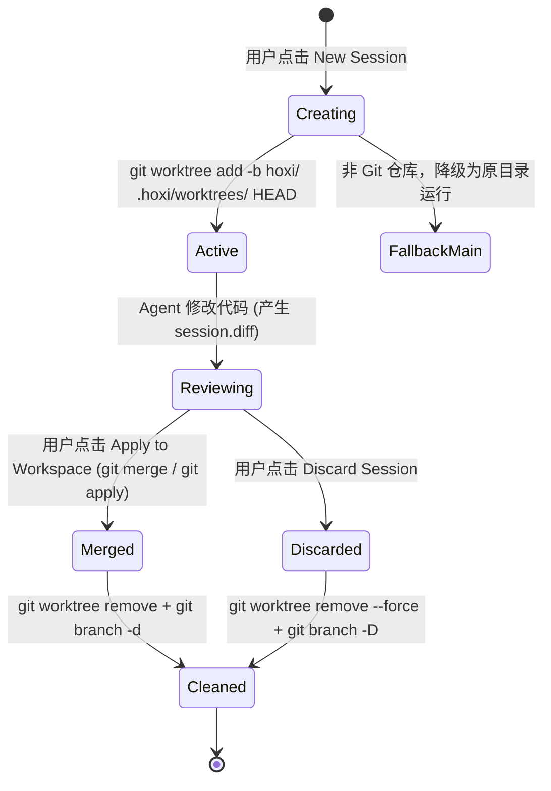

# hoxi 开发者全景与工程实现手册 (DEVELOPMENT.md)

本文档是 `hoxi` 的**生产级工程实现规范（Implementation-Ready Blueprint）**。文档中的所有接口路径、SSE 事件载荷、审批门控、Git Worktree 状态机及 Wails/CGo 原生宿主架构均对齐 **Hoxi 内置 Go 原生 Agent 引擎（`internal/agent`，零外部 sidecar 依赖）**、**统一 `/api/hoxi/*` 网关平面**、**三栏 SolidJS 工作区架构** 以及 **多运行时适配引擎（`internal/runner`）**，与 [`AGENTS.md`](AGENTS.md) 和 [`docs/architecture-overview.md`](docs/architecture-overview.md) 共同构成开发与验收的事实来源。

---

## 目录

1. [架构全景与设计哲学](#1-架构全景与设计哲学)
2. [技术栈选型与职责边界](#2-技术栈选型与职责边界)
3. [Go 原生宿主网关与可选外部引擎兼容规范](#3-go-原生宿主网关与可选外部引擎兼容规范)
   - [3.1 默认进程内原生启动与按需兼容子进程](#31-默认进程内原生启动与按需兼容子进程)
   - [3.2 回环网关鉴权与本地代理防劫持](#32-回环网关鉴权与本地代理防劫持)
   - [3.3 SSE 零缓冲流式推送与 WebSocket 终端升级](#33-sse-零缓冲流式推送与-websocket-终端升级)
4. [统一 `/api/hoxi/*` 网关平面与通信契约](#4-统一-apihoxi-网关平面与通信契约)
   - [4.1 客户端统一网关平面端点对照表](#41-客户端统一网关平面端点对照表)
   - [4.2 发送异步 Prompt 与模式/模型切换](#42-发送异步-prompt-与模式模型切换)
   - [4.3 权限审批与追问回复契约](#43-权限审批与追问回复契约)
   - [4.4 内置 PTY 终端与 WebSocket 协议](#44-内置-pty-终端与-websocket-协议)
5. [SSE `/api/hoxi/event` 实时事件流与前端状态机](#5-sse-apihoxievent-实时事件流与前端状态机)
   - [5.1 真实 SSE 事件类型与 TypeScript 定义](#51-真实-sse-事件类型与-typescript-定义)
   - [5.2 120Hz `requestAnimationFrame` 流式批处理引擎](#52-120hz-requestanimationframe-流式批处理引擎)
6. [前端 UI 架构：三栏工作区外壳 + Kilo 任务流](#6-前端-ui-架构三栏工作区外壳--kilo-任务流)
   - [6.1 视觉 Token 与低饱和暗黑规范](#61-视觉-token-与低饱和暗黑规范)
   - [6.2 三栏工作区布局 (`ThreePaneShell`)](#62-三栏工作区布局-threepaneshell)
   - [6.3 Kilo Code 风格动态工具卡片 (`ToolCard`)](#63-kilo-code-风格动态工具卡片-toolcard)
   - [6.4 独立推理抽屉 (`ThoughtBox`) 与内联审批门控 (`ApprovalGateCard`)](#64-独立推理抽屉-thoughtbox-与内联审批门控-approvalgatecard)
   - [6.5 Pierre Diff 审查器与 WebGL Xterm 终端集成](#65-pierre-diff-审查器与-webgl-xterm-终端集成)
   - [6.6 三大高阶控制能力](#66-三大高阶控制能力)
7. [Git Worktree 物理会话隔离与合并生命周期](#7-git-worktree-物理会话隔离与合并生命周期)
   - [7.1 Worktree 沙箱状态机](#71-worktree-沙箱状态机)
   - [7.2 Go Worktree 管理器接口契约 (`internal/worktree/`)](#72-go-worktree-管理器接口契约-internalworktree)
8. [统一安全门控与 8 维记忆沉淀体系](#8-统一安全门控与-8-维记忆沉淀体系)
   - [8.1 原生门控钩子与可选 OpenCode 插件签名](#81-原生门控钩子与可选-opencode-插件签名)
   - [8.2 统一审批策略门控 (`approval_decision.go` & `permission-policy.js`)](#82-统一审批策略门控-approval_decisiongo--permission-policyjs)
   - [8.3 8 维度结构化记忆沉淀 (`internal/runner/memory.go` & `.hoxi/memory/`)](#83-8-维度结构化记忆沉淀-internalrunnermemorygo--hoximemory)
9. [macOS & Windows 原生宿主与状态栏托盘 (`internal/app/` & `internal/statusbar/`)](#9-macos--windows-原生宿主与状态栏托盘-internalapp--internalstatusbar)
   - [9.1 Wails 窗口配置与单实例锁](#91-wails-窗口配置与单实例锁)
   - [9.2 原生状态栏 / 系统托盘状态机联动](#92-原生状态栏--系统托盘状态机联动)
10. [默认原生引擎、多运行时适配与会话接管 (`internal/agent/`, `internal/runner/`, `internal/handoff/`)](#10-默认原生引擎多运行时适配与会话接管-internalagent-internalrunner-internalhandoff)
11. [远程访问与多通道接入架构 (`internal/tunnel/`, `internal/pairing/`, `internal/cloudflared/`)](#11-远程访问与多通道接入架构-internaltunnel-internalpairing-internalcloudflared)

---

专项规范文档：[Skills 开发与集成规范](docs/skills-development.md)（标准 `SKILL.md`、内置默认技能、hoxi.ai 技能市场与跨运行时适配规范）。

## 1. 架构全景与设计哲学

`hoxi` 的核心定位是：**专为全功能 AI Agent 打造的高颜值、轻量化、原生质感桌面工作台**。项目通过四层解耦架构，将核心工程能力融为一体（完整目录树与模块归属决策表以 [`AGENTS.md`](AGENTS.md) 与 [`docs/architecture-overview.md`](docs/architecture-overview.md) 为唯一权威来源）：

```text
┌────────────────────────────────────────────────────────────────────────┐
│ 1. 原生宿主层 (Desktop Host: internal/app & internal/statusbar)        │
│    - Wails v2 + WKWebView / WebView2 (~0.2s 极速冷启动, ~30MB 内存)     │
│    - macOS 原生毛玻璃背景 (Vibrancy) + 沉浸式无边框交通灯标题栏         │
│    - macOS NSStatusBar / Windows Shell_NotifyIconW 托盘 (Running/待批) │
│    - 单实例运行锁 (SingleInstanceLock) + 关窗隐藏窗口后台常驻           │
├────────────────────────────────────────────────────────────────────────┤
│ 2. 前端工作区 (Frontend UI: web/src/{components,store,services,i18n})  │
│    - 外壳布局：经典三栏 (左侧项目/工作树 + 中间对话 + 右侧审查)          │
│    - 任务交互：Kilo Code 动态工具卡片、独立 Reasoning 抽屉、内联审批门控│
│    - 核心引擎：Vite + SolidJS + Tailwind CSS (零 VDOM，120Hz 满帧流式)  │
│    - 审查与终端：@pierre/diffs Hunk 级代码对比 + @xterm/addon-webgl     │
├────────────────────────────────────────────────────────────────────────┤
│ 3. Go 原生宿主服务与安全网关 (internal/{gateway,termhost,worktree,...}) │
│    - 统一网关平面 (internal/gateway)：/api/hoxi/* 路由与会话目录隔离守卫│
│    - 原生终端宿主 (internal/termhost)：进程内 PTY 与 WebSocket 双向流    │
│    - Hoxi 会话与记忆存储：~/.hoxi/sessions/<id>/ 与 <repo>/.hoxi/memory│
│    - Git Worktree 沙箱引擎 (internal/worktree)：`.hoxi/worktrees/<id>`  │
├────────────────────────────────────────────────────────────────────────┤
│ 4. 默认 Go 原生引擎与多运行时内核 (internal/agent & internal/runner)    │
│    - 默认内置引擎：Go Native Agent Engine (`native`, 零外部 sidecar)    │
│    - 可选外部 CLI 运行时：Claude Code / Codex / OpenCode / Antigravity  │
│      (`agy`) / Gemini CLI / Qoder / CodeBuddy                          │
└────────────────────────────────────────────────────────────────────────┘
```

### 核心铁律：原生优先与外部 CLI 零侵入（Native-First & Zero-Fork）
Hoxi 默认开箱即用运行内置 **Go 原生 Agent 引擎**（`internal/agent`），不依赖外部 sidecar 二进制；对用户可选接入的外部 CLI（`claude`、`codex`、`opencode`、`agy`、`gemini`、`qoder`、`codebuddy`）严禁 Fork 或修改上游源码，统一通过 `internal/runner` 进程适配与 PreToolUse 门控协同。项目状态与扩展目录统一写 `<project>/.hoxi/` 与 `~/.hoxi/`，严禁在用户项目创建 `.opencode/`。

---

## 2. 技术栈选型与职责边界

| 层级 | 技术栈与核心依赖 | 借鉴定点与选型依据 |
| :--- | :--- | :--- |
| **桌面宿主** | Go `>= 1.25` + Wails `v2.13+` + CGo / Win32 | 模块化收归于 `internal/app` 与 `internal/statusbar`（含 `statusbar_darwin.m` 与 `statusbar_windows.go`）。 |
| **前端视图层** | SolidJS `^1.9` + TypeScript `^5.7` + Vite `^6.0` | 与 `Kilo Code` (`packages/kilo-ui`) 同源技术栈；细粒度 Signal 响应式直接操作真实 DOM，流式渲染零虚拟 DOM 开销。 |
| **样式系统** | Tailwind CSS `^4.0` + CSS Variables | 深邃暗黑极简调性（`#0b0d12` 底色 + `1px` 微光边框 + 等宽数值对齐）。 |
| **代码 Diff** | `@pierre/diffs` | 渲染 Hoxi Worktree / 会话返回的 `SnapshotFileDiff` / Unified Patch，支持 Inline 与 Side-by-Side 切换。 |
| **终端组件** | `@xterm/xterm` + `@xterm/addon-webgl` + `@xterm/addon-fit` | 直连 Hoxi 原生终端宿主 `/api/hoxi/pty/{ptyID}/connect` WebSocket 终端流，支持 GPU 加速与窗口自适应。 |
| **Agent 内核** | `internal/agent` (`native` 默认) + `internal/runner` | 内置 Anthropic / OpenAI / Gemini 协议、文件/Shell/代码索引/宿主工具循环，并统一驱动多外部 CLI 运行时。 |

---

## 3. Go 原生宿主网关与可选外部引擎兼容规范

### 3.1 默认进程内原生启动与按需兼容子进程
Hoxi 启动时（[`internal/app/app.go`](internal/app/app.go)）默认运行纯 Go 原生引擎（`openCodePort = 0`），直接就绪而无需拉起任何外部守护进程，冷启动耗时约 **~0.2s**、常驻内存约 **~30MB**。

当用户显式安装并启用可选的 `opencode` 守护进程模式时（[`internal/app/supervise.go`](internal/app/supervise.go) + [`internal/opencode/`](internal/opencode/)），才按需以回环空闲端口启动 `opencode serve --hostname 127.0.0.1 --port <free-port> --print-logs`，并注入：
1. `OPENCODE_SERVER_PASSWORD=<32-byte-random-hex>` 與 `OPENCODE_SERVER_USERNAME=opencode`（绝不落盘）。
2. `OPENCODE_DISABLE_CONFIG_DEPENDENCY_INSTALL=1`：禁止在 `.opencode/` 联网自动安装依赖。
3. `NO_PROXY=127.0.0.1,localhost`：防止子进程内部回环请求被系统代理拦截。
4. 状态与配置目录统一由 [`internal/hoxipaths`](internal/hoxipaths/hoxipaths.go) 解析在 `~/.hoxi/` 下。

### 3.2 回环网关鉴权与本地代理防劫持
1. **每次启动生成一次性 `gatewayToken`**：由 `/api/hoxi/bootstrap` 下发给本机桌面前端与 CLI（远程隧道请求绝不下发），回环敏感宿主路由（`/api/hoxi/pty`、`/api/hoxi/provider/{credentials,config,catalog,oauth}` 等）强制校验 `X-Hoxi-Token` / `HttpOnly` Cookie / `?hoxiToken=`（[`internal/gateway/security.go`](internal/gateway/security.go)）。
2. **防系统 HTTP_PROXY 劫持**：macOS / Windows 开发者常开启 Clash / Surge 等系统代理。回环客户端（[`internal/opencode/ocapi`](internal/opencode/ocapi/client.go)）显式配置 `Proxy: nil` 与 `FlushInterval: -1`，彻底杜绝本机回环 `502 Bad Gateway` 与流式缓冲延迟。

### 3.3 SSE 零缓冲流式推送与 WebSocket 终端升级
1. **静态资源与 `/api/hoxi/*` 路由分流（[`internal/gateway/gateway.go`](internal/gateway/gateway.go)）**：
   - `/api/hoxi/*` 统一承载会话、事件流、审批、终端 PTY、Agent/Command 目录、LSP 状态、Skills、文件检索/预览、Worktree、浏览器与电脑控制（同时在 [`native_host.go`](internal/gateway/native_host.go) 保留旧无前缀兼容别名供存量测试与插件回退）。
   - 其余非 API 路径回退给 `web/dist` 前端静态资源（SPA History 路由回退至 `index.html`）。
2. **WebSocket 终端连接方案**：
   - Wails 的 `AssetServer.Handler` 基于自定义 `wails://` Scheme 拦截 HTTP 请求，不支持直接在 `wails://` 上 Upgrade WebSocket。
   - Go 宿主在本地回环（release `127.0.0.1:5410`、dev `127.0.0.1:5420`，占用自动回退随机端口）开启轻量级 HTTP/WS 监听器，经 `/api/hoxi/bootstrap` 下发 `wsBaseURL` 与 `gatewayToken`。前端 Xterm 组件连接 `ws://127.0.0.1:<port>/api/hoxi/pty/{ptyID}/connect?directory=...&hoxiToken=...`，直连 [`internal/termhost`](internal/termhost/service.go) 双向字节流。

---

## 4. 统一 `/api/hoxi/*` 网关平面与通信契约

> [!IMPORTANT]
> **统一 `/api/hoxi/*` 网关平面强制约束（见 `AGENTS.md` §2.2 第 3 条）**：
> - **前端（`web/src/services/api.ts`、`sse.ts`）、CLI 与手机端**的所有会话操作**必须**调用 `/api/hoxi/sessions`，事件流**必须**订阅 `/api/hoxi/event`，权限审批**必须**调用 `/api/hoxi/permission`，宿主终端、目录、LSP、文件与提供商统一走 `/api/hoxi/{pty,agents,commands,lsp,file,provider}`。
> - **严禁前端或 CLI 直接裸调旧版无前缀路径（`/session`、`/event`、`/permission`、`/pty`、`/agent`、`/command`、`/lsp`、`/find/file`、`/provider`、`/auth`、`/global`）**。
> - 所有关联特定会话或沙箱的请求均必须携带 `?directory=<urlencoded-worktree-path>` 参数。

### 4.1 客户端统一网关平面端点对照表

| 功能模块 | 前端 / CLI / 手机端统一入口（必走） | 宿主实现包 | 请求体 / 响应说明 |
| :--- | :--- | :--- | :--- |
| **健康与引导** | `GET /healthz` / `GET /api/hoxi/bootstrap` | `internal/gateway` | 返回版本、默认工作区、`wsBaseURL`、本机 `gatewayToken` 与托盘摘要 |
| **全局事件流** | `GET /api/hoxi/event?directory=` | `internal/runner` | SSE `text/event-stream`，首帧及每 10s 推送 `hoxi.status.snapshot` 与 `server.heartbeat` |
| **会话列表** | `GET /api/hoxi/sessions?directory=&limit=50` | `internal/runner` | 返回当前工作区或全局 `SessionInfo[]` 列表 |
| **创建会话** | `POST /api/hoxi/sessions?directory=` | `internal/runner` | `{"title"?: string, "runtime"?: "native" \| string}` -> 默认创建 `native` 会话 (`id: "ses_..."`) |
| **更新/删除会话**| `PATCH\|DELETE /api/hoxi/sessions/{sessionID}?directory=` | `internal/runner` | 重命名标题、归档、切换沙箱或删除会话 |
| **读取消息流** | `GET /api/hoxi/sessions/{sessionID}/message?directory=&limit=N&before=` | `internal/runner` | 支持游标冷分页（桌面端首屏最新 200 条），返回 `Array<{ info: Message, parts: Part[] }>` |
| **异步发消息** | `POST /api/hoxi/sessions/{sessionID}/prompt_async?directory=` | `internal/runner` | 见 [4.2 节](#42-发送异步-prompt-与模式模型切换)，支持 `X-Idempotency-Key`，结果由 `/api/hoxi/event` 推送 |
| **终止执行** | `POST /api/hoxi/sessions/{sessionID}/abort?directory=` | `internal/runner` | 立即中断当前会话正在运行的生成或工具调用 |
| **时光机回滚** | `POST /api/hoxi/sessions/{sessionID}/revert?directory=` | `internal/runner` + `worktree` | `{"messageID": "msg_...", "partID"?: "prt_..."}`，回滚对话与磁盘文件快照（运行中返回 `409`） |
| **撤销回滚** | `POST /api/hoxi/sessions/{sessionID}/unrevert?directory=` | `internal/runner` + `worktree` | `{}`，恢复刚被 `revert` 撤回的对话与代码变更 |
| **会话分叉** | `POST /api/hoxi/sessions/{sessionID}/fork?directory=` | `internal/runner` | `{"messageID"?: "msg_..."}`，从指定消息节点克隆分叉新会话 |
| **会话级 Diff** | `GET /api/hoxi/sessions/{sessionID}/diff?directory=` | `internal/worktree` | 返回 `SnapshotFileDiff[]`（含 `file`, `patch`, `additions`, `deletions`） |
| **权限审批列表/回复**| `GET /api/hoxi/permission?directory=`<br>`POST /api/hoxi/permission/{requestID}/reply?directory=` | `internal/runner` | `{"reply": "once" \| "always" \| "reject", "message"?: string}`，统一处理全运行时审批 |
| **Agent 追问回复**| `GET /api/hoxi/question?directory=`<br>`POST /api/hoxi/question/{requestID}/{reply,reject}?directory=` | `internal/runner` | `{"answers": string[][]}`，回复或拒绝 Agent 发出的交互式选择题 |
| **终端 PTY** | `POST /api/hoxi/pty?directory=`<br>`PUT\|DELETE /api/hoxi/pty/{ptyID}?directory=` | `internal/termhost` | 创建、调整尺寸与销毁本地 PTY 终端，WS 连接 `/api/hoxi/pty/{ptyID}/connect`（仅本机） |
| **Agent / 命令 / LSP** | `GET /api/hoxi/{agents,commands,lsp}?directory=` | `internal/gateway` + `llm` | 获取内置与 `.hoxi/` 自定义角色、斜杠命令及工作区语言工具链状态 |
| **Provider / 文件**| `GET /api/hoxi/provider/{catalog,models,config}`、`GET /api/hoxi/file/{list,search,content}` | `internal/provider` + `gateway` | 提供商目录、凭据（`/api/hoxi/provider/credentials/{id}`）与受守卫的工作区文件检索/读取 |

### 4.2 发送异步 Prompt 与模式/模型切换
在前端用户输入指令并点击发送时，统一调用 **`POST /api/hoxi/sessions/{sessionID}/prompt_async?directory=<worktreePath>`**（严禁直调 `/session/{sessionID}/prompt_async`），HTTP 请求立即返回 `204`，所有 Token 增量与工具状态由 `/api/hoxi/event` SSE 统一驱动：

```typescript
export interface SessionPromptInput {
  messageID?: string; // 可选，格式 ^msg
  agent?: "build" | "plan" | string; // 对应底部 Mode 切换器：build(读写执行) / plan(只读规划)
  model?: {
    providerID: string; // 如 "anthropic", "openai", "deepseek"
    modelID: string;    // 如 "claude-sonnet-4-20250514", "deepseek-chat"
  };
  variant?: string;     // 推理强度变体，如 "high" / "max"
  system?: string;      // 附加系统提示词
  skillSelection?: { key: string; name: string }; // 可选，显式请求加载指定 Skill
  parts: Array<
    | { type: "text"; text: string }
    | { type: "file"; mime: string; filename?: string; url: string }
  >;
}
```

### 4.3 权限审批与追问回复契约
当 Agent 触发需要人工确认的操作（未被 Go 统一审批策略 `approvalAutoApproves` 自动放行的请求，或任何模式下的 `rm -rf`、`sudo`、`.env` 读取、受保护路径写入等）时：
1. `/api/hoxi/event` SSE 收到 `permission.asked` 事件，包含 `id`（即 `requestID`，OpenCode 为 `per_...`，Runner 为 `per_rnr_...`）、`sessionID`、`permission`（如 `"bash"` 或 `"edit"`）、`patterns`（命令内容或路径列表）、`metadata`、`tool: { messageID, callID }`。
2. 用户在前端 `ApprovalGateCard` 点击按钮后，前端统一调用：
   ```http
   POST /api/hoxi/permission/{requestID}/reply?directory=<worktreePath>
   Content-Type: application/json

   {
     "reply": "once" // "once" (仅本次放行) | "always" (仅本会话、仅内存、可撤销) | "reject" (拒绝并附带原因)
   }
   ```

   `always` 的语义按运行时区分：Runner（Claude Code / Antigravity / Gemini CLI）对 `bash` 记住**完全相同的整条命令**，对工具记住 **工具名 + 完整参数哈希**；OpenCode 侧由 Go 统一审批策略（`~/.hoxi/approval-policy.json`）与全局 `permission` 精确对象规则（自动补 `"*": "ask"` 兜底）共同决定。会话级授权只存在于内存（进程重启即失效），破坏性命令永不记忆，可在设置页「当前会话临时放行授权」查看与撤销。经 GoPanel 隧道回复时 `always` 一律返回 403，手机端只能 `once` / `reject`。

   卡片内的「放行规则」列表是即时生效的写入路径：点「始终允许 / 始终拒绝」会直接落盘对应规则并同时回复本次请求，不必再点外侧按钮（`approval-helpers.ts` 的 `rulesForReply` / `exactAllowRules`）。**只持久化精确规则**：OpenCode 在 `permission.ask` 之前就按已保存的 glob 模式判定，因此 `git *`、`npm *`、`*` 这类通配前缀绝不写入全局 `permission`（否则 `git push --force` 会绕过审批门控），只通过本次 `reply: "always"` 的会话授权生效；「始终拒绝」可持久化通配前缀（fail closed）。破坏性请求隐藏「始终允许」，只保留「始终拒绝」。

   每一次完成决策（桌面、隧道或系统自动拒绝）都会写入 `~/.hoxi/approval-audit.json`（原子写入、`0600`、最多 500 条、密钥自动脱敏），可在 `GET /api/hoxi/permission/audit` 查询；该接口与 `GET|DELETE /api/hoxi/permission/grants` 都仅限桌面本机。

### 4.4 内置 PTY 终端与 WebSocket 协议
右侧审查面板的 `Terminal` 标签页直接对接 Hoxi 原生 PTY 终端宿主（[`internal/termhost/`](internal/termhost/service.go)）：
1. **创建终端会话**：
   `POST /api/hoxi/pty?directory=<worktreePath>`
   请求体：`{"cwd": "<worktreePath>", "title": "Hoxi Terminal"}` -> 返回 `Pty` 对象（含 `id: "pty_..."`）。
2. **连接实时终端流**：
   通过 WebSocket 连接 `ws://127.0.0.1:<gateway-port>/api/hoxi/pty/{ptyID}/connect?directory=<worktreePath>&hoxiToken=<token>`，双向收发终端 stdin/stdout 原始字符流。
3. **窗口尺寸同步与销毁**：
   当 Xterm `@xterm/addon-fit` 触发 `onResize({ cols, rows })` 时调用 `PUT /api/hoxi/pty/{ptyID}` 发送 `{"size": {"rows": rows, "cols": cols}}`；关闭终端时调用 `DELETE /api/hoxi/pty/{ptyID}`。

---

## 5. SSE `/api/hoxi/event` 实时事件流与前端状态机

### 5.1 真实 SSE 事件类型与 TypeScript 定义
> [!WARNING]
> **修正历史文档误区**：
> `/api/hoxi/event` 统一事件流发送的是点号分隔的真实事件名（如 `message.part.updated`、`message.part.delta`、`permission.asked`），且思考推理块的类型名为 **`type: "reasoning"`**（而非 `"thought"`）！前端必须严格按以下 TypeScript 契约解析：

```typescript
// web/src/services/sse-types.ts

export type HoxiEvent =
  | {
      type: "message.updated";
      properties: { sessionID: string; info: MessageInfo };
    }
  | {
      type: "message.part.updated";
      properties: { sessionID: string; part: MessagePart };
    }
  | {
      type: "message.part.delta";
      properties: {
        sessionID: string;
        messageID: string;
        partID: string;
        field: "text" | string;
        delta: string;
      };
    }
  | {
      type: "permission.asked";
      properties: {
        id: string;          // requestID，用于 POST /permission/{id}/reply
        sessionID: string;
        permission: string;  // "bash" | "edit" | "webfetch" | ...
        patterns: string[];  // 具体命令或文件路径
        metadata: Record<string, any>;
        always: string[];
        tool?: { messageID: string; callID: string };
      };
    }
  | {
      type: "permission.replied";
      properties: {
        sessionID: string;
        requestID: string;
        reply: "once" | "always" | "reject";
      };
    }
  | {
      type: "session.status";
      properties: {
        sessionID: string;
        status:
          | { type: "idle" }
          | { type: "busy" }
          | { type: "retry"; attempt: number; message: string; next: number };
      };
    }
  | {
      type: "session.diff";
      properties: {
        sessionID: string;
        diff: SnapshotFileDiff[];
      };
    }
  | {
      // 全局执行状态快照（仅 Hoxi 自有，非 OpenCode 原生）：连接建立时与每次
      // SSE tick 推送一次，覆盖所有项目的托管会话。`scope: "managed"` 表示
      // 该集合来自 runner 进程表，未被列出的托管会话即为 idle；客户端因此不必
      // 按项目轮询，切换项目也不会把其它项目正在运行的会话误判为空闲。
      type: "hoxi.status.snapshot";
      properties: {
        scope: "managed";
        busy: string[];
        stalled?: Record<string, number>; // sessionID -> 停滞开始时间（unix ms）
      };
    }
  | {
      type: "session.error";
      properties: {
        sessionID?: string;
        error?: { name: string; data: Record<string, any> };
      };
    };

export type MessagePart =
  | {
      id: string;
      sessionID: string;
      messageID: string;
      type: "text";
      text: string;
    }
  | {
      id: string;
      sessionID: string;
      messageID: string;
      type: "reasoning"; // 注意：思考链的真实类型是 "reasoning"
      text: string;
      time: { start: number; end?: number };
    }
  | {
      id: string;
      sessionID: string;
      messageID: string;
      type: "tool";
      callID: string;
      tool: string;      // 如 "bash", "read", "edit", "write", "grep", "glob"
      state: ToolState;
    }
  | {
      id: string;
      sessionID: string;
      messageID: string;
      type: "patch";
      hash: string;
      files: string[];
    };

export type ToolState =
  | { status: "pending"; input: Record<string, any>; raw: string }
  | {
      status: "running";
      input: Record<string, any>;
      title?: string;
      metadata?: Record<string, any>;
      time: { start: number };
    }
  | {
      status: "completed";
      input: Record<string, any>;
      output: string;
      title: string;
      metadata: Record<string, any>;
      time: { start: number; end: number; compacted?: number };
    }
  | {
      status: "error";
      input: Record<string, any>;
      error: string;
      metadata?: Record<string, any>;
      time: { start: number; end: number };
    };

export interface SnapshotFileDiff {
  file: string;
  patch?: string;
  additions: number;
  deletions: number;
  status?: "added" | "deleted" | "modified";
}
```

### 5.2 120Hz `requestAnimationFrame` 流式批处理引擎
当大模型高速吐出 Token 时，`message.part.delta` 每秒可能触发上百次。为保证界面 120Hz 丝滑不掉帧，`web/src/services/sse.ts` 必须使用微任务缓冲池 + `requestAnimationFrame` 合并更新 SolidJS Store：

```typescript
// web/src/services/sse.ts 核心节流逻辑
const pendingDeltas = new Map<string, string>(); // key: `${messageID}:${partID}:${field}`
let rafId: number | null = null;

function scheduleFlush(applyDeltaToStore: (key: string, delta: string) => void) {
  if (rafId !== null) return;
  rafId = requestAnimationFrame(() => {
    rafId = null;
    for (const [key, accDelta] of pendingDeltas.entries()) {
      applyDeltaToStore(key, accDelta);
    }
    pendingDeltas.clear();
  });
}
```

---

## 6. 前端 UI 架构：三栏工作区外壳 + Kilo 任务流

### 6.1 视觉 Token 与低饱和暗黑规范
采用深色工业质感与 `Kilo Code` 的状态语义色：

```css
:root {
  --bg-canvas: #0b0d12;          /* 主画布深邃背景 */
  --bg-panel: #10141d;           /* 左右侧边栏底色 */
  --bg-elevated: #161b26;        /* 卡片与悬浮层底色 */
  --border-subtle: rgba(255, 255, 255, 0.07); /* 1px 极细分割线 */
  --border-focus: rgba(99, 102, 241, 0.45);   /* 激活态微光边框 */
  --text-primary: #f3f4f6;
  --text-secondary: #9ca3af;
  --text-muted: #6b7280;
  --accent-primary: #6366f1;     /* Indigo 核心主色 */
  --status-running: #3b82f6;     /* 蓝色脉冲：工具执行中 */
  --status-success: #10b981;     /* 翠绿指示：执行成功 */
  --status-warning: #f59e0b;     /* 琥珀警告：待人工审批 */
  --status-danger: #ef4444;      /* 绯红告警：执行报错或拒绝 */
  --font-sans: "Inter", -apple-system, BlinkMacSystemFont, sans-serif;
  --font-mono: "JetBrains Mono", "SF Mono", Menlo, monospace;
}
```

### 6.2 三栏工作区布局 (`ThreePaneShell`)
1. **顶栏 (`CompactHeader` - 高度 `38px`)**：
   - 左侧预留 `76px` 空白区供 macOS 原生红绿灯（Traffic Lights）嵌入，整栏设置 `style="--wails-draggable: drag"` 支持拖拽窗口。
   - 中间展示当前项目名、Git Worktree 沙箱分支胶囊（如 `hoxi/ses_01J...`）以及一键合入按钮 `Apply to Main`。
   - 右侧展示引擎运行状态指示灯与右侧审查栏折叠开关。
2. **左栏 (`LeftNav` - 默认 `268px`，可拖拽缩放 `220–360px`，开关与宽度持久化)**：
   - 顶部 `+ New Isolated Session` 按钮（点击触发 Worktree 沙箱创建 + Hoxi 默认 `native` 会话创建）。
   - 按时间分组的会话列表（支持 Single / Multi / Running / Attention 视图切换），每项实时展示：会话标题、状态徽标（蓝点 Running / 黄点 Approval / 空闲）、Git 分支 / PR 状态胶囊，并将非归档子 Agent 会话（Subagent / Convoy 子任务）折叠归组在根父会话下方（子会话运行中、待审批、被选中或命中搜索时自动展开）。
3. **中栏 (`MessageStream` + `Composer` - 弹性自适应 `flex-1`，目标最小 `560px`)**：
   - 消息流按 `MessagePart` 顺序渲染：`ReasoningPart` -> `ToolPart` -> `TextPart`。
   - 底部 Composer 支持：
     - `Mode` 切换胶囊：`Build`（全权限编码） / `Plan`（只读架构规划）。
     - `Model` 选择器：读取 `GET /api/hoxi/provider/catalog` 动态切换模型。
     - `@` 符号唤起文件模糊搜索（调用 `GET /api/hoxi/file/search`）。
     - 生成中展示红色 `Stop` 按钮（调用 `POST /api/hoxi/sessions/{id}/abort`）。
4. **右栏 (`InspectorPane` - 默认 `420px`，可拖拽 `340–640px`，按可用宽度动态收窄，空间不足时自动收起，宽度持久化)**：
   - 高频标签页：`Diffs (N)` | `Memory (8-Dim)` | `Files` | `Terminal` | `Browser` | `Computer`。

### 6.3 Kilo Code 风格动态工具卡片 (`ToolCard`)
每个 `ToolPart` (`type === "tool"`) 根据 `state.status` 呈现四种视觉形态：
- **`pending` / `running`**：左侧蓝色呼吸脉冲动画（`animate-pulse`），展示工具图标（`read` / `edit` / `bash` / `grep`）、目标文件或命令摘要，右侧使用 `setInterval(100ms)` 实时跳动耗时秒表（如 `1.4s`）。
- **`completed`**：左侧变为翠绿色对勾，右侧定格总耗时（`time.end - time.start` ms）。点击卡片头部可展开查看格式化后的 `state.input` 与 `state.output`（若为 `edit` 工具，直接内嵌渲染微型 Pierre Diff 块）。
- **`error`**：红色边框高亮，默认展开显示 `state.error` 堆栈详情。

### 6.4 独立推理抽屉 (`ThoughtBox`) 与内联审批门控 (`ApprovalGateCard`)
- **`ThoughtBox`**：绑定 `ReasoningPart` (`type === "reasoning"`)。在 `time.end` 未到达前显示 `Thinking...` 动态微光标题并自动流式滚动最新推理行；当 `time.end` 到达后，标题更新为 `Thought for X.Xs` 并自动平滑折叠，保持主回答区干净清爽。
- **`ApprovalGateCard`**：绑定 `permission.asked` 事件。内联插入在当前执行流底部，带琥珀色高亮边框，清晰列出请求的权限类型（如 `bash`）与完整命令字符串，提供：
  - `[Approve Once]` -> `reply: "once"`
  - `[Always Allow Command/Call in Session]` -> `reply: "always"`（Runner 请求按命令或工具+参数区分，破坏性请求不显示该按钮）
  - `[Reject]` -> `reply: "reject"`（可附原因；Runner 作为 deny 理由回给模型，OpenCode 作为拒绝说明，不再额外下发新 prompt）
  - 「放行规则」列表的 `始终允许 / 始终拒绝` 是即时生效路径：点击即写入对应规则并同时回复本次请求；仅精确规则落盘，通配前缀只走本次会话授权

### 6.5 Pierre Diff 审查器与 WebGL Xterm 终端集成
- **`PierreDiffViewer`**：监听 `session.diff` 事件或调用 `GET /api/hoxi/sessions/{sessionID}/diff`，将返回的 `SnapshotFileDiff[]` 渲染为可折叠的文件变更卡片列表，支持一键切换 `Unified` 与 `Split` 视图。
- **`WebGLTerminal`**：基于 `@xterm/xterm` + `@xterm/addon-webgl` 初始化，挂载时自动请求 `POST /api/hoxi/pty` 获取 `ptyID` 并连接 WebSocket，确保在桌面工作台内拥有接近 iTerm2 的零延迟命令行体验。

### 6.6 三大高阶控制能力
为确保在执行控制力上提供全维度闭环体验，前端与宿主引擎额外集成以下三项高阶机制：

1. **执行中途“实时插话纠偏”（Live Guidance / Steering）**：
   - 当会话处于 `session.status.type === "busy"`（Agent 正在连续调用工具）时，底部 `Composer` 输入框**保持可输入状态**，右侧主按钮切换为紫色的 **`[Steer 实时纠偏]`**（旁边保留独立的红色 `[Stop]` 按钮）。
   - 用户在 Agent 执行中途发送纠偏指令时，前端统一调用 `POST /api/hoxi/sessions/{sessionID}/prompt_async?directory=...` 追加指导消息。Hoxi 原生引擎（`native`）与可选 OpenCode 运行时会在当前工具步骤完成后立即将该纠偏指令并入下一轮上下文，无需粗暴中断重来。
2. **单步级“代码时光机回滚”与“分支探索”（Checkpoint Revert & Session Fork）**：
   - 在每条用户消息及每张已完成的文件修改 `ToolCard` 右上角提供两个快捷微交互按钮：
     - **`[Revert to Here 回滚到此步]`**：经统一 `POST /api/hoxi/sessions/{sessionID}/revert?directory=...`（传入 `{ messageID, partID }`）回退消息与对应文件检查点。执行中（含重试等待）禁用回退，后端对运行中的任务返回 409，绝不隐式停止主任务或子任务；“立即发送”已送入运行时的消息目前不能无中断撤回。仅实际恢复文件时显示 `[Undo Revert 恢复重做]` 提示条（绑定统一 `POST /api/hoxi/sessions/{sessionID}/unrevert` 路由）；纯消息回退不显示代码回滚提示。请求失败时保留原消息、回退状态与输入草稿。
     - **`[Fork 分叉探索]`**：经统一 `POST /api/hoxi/sessions/{sessionID}/fork?directory=...`（传入 `{ messageID }`），从当前节点瞬间克隆出一条新会话，方便对比两种不同的技术重构路径。
3. **工具链与编译器诊断闭环（Diagnostics）**：
   - 顶栏与右侧审查栏可查看当前工作区语言工具链状态（读取 `GET /api/hoxi/lsp`）。
   - 当 Agent 调用 `edit` 或 `write` 修改代码后，引擎抓取编译器语法/类型报错（Diagnostics）并附带在工具返回结果（`ToolStateCompleted.output` / `metadata`）中，触发 Agent 自动修复。

---

## 7. Git Worktree 物理会话隔离与合并生命周期

借鉴 `gopanel_v2/app/api/code_worktree.go` 的成熟工程实践，每个会话默认运行在独立的 Git Worktree 沙箱中，支持多个 Agent 会话同时重构不同模块而互不踩踏。

### 7.1 Worktree 沙箱状态机



### 7.2 Go Worktree 管理器接口契约 (`internal/worktree/`)
[`internal/worktree/routes.go`](internal/worktree/routes.go) 与 [`internal/worktree/manager.go`](internal/worktree/manager.go) 暴露的核心管理接口：

1. **`POST /api/hoxi/worktree/create`**
   - 输入：`{"sessionID": "ses_xxx"}`
   - 动作：
     1. 校验主工程是否为 Git 仓库（`git rev-parse --show-toplevel`）。若不是，返回 `{"isolated": false, "directory": "<rootDir>"}`。
     2. 创建沙箱路径 `<rootDir>/.hoxi/worktrees/<sessionID>`，并确保 `.hoxi/` 已写入 `.gitignore` 或 `.git/info/exclude`。
     3. 执行：`git -c checkout.workers=0 worktree add -b hoxi/<sessionID> <worktreeDir> HEAD`。
     4. 仅当主工程已存在 `<rootDir>/.opencode` 目录时，才在工作树中创建指向它的 `.opencode` 软链接以复用项目插件与技能（严禁在无 `.opencode` 的用户仓库中创建该目录；记忆统一存储在 `<rootDir>/.hoxi/memory/`，从不写入 `.opencode`）。
     5. 返回 `{"isolated": true, "directory": "<worktreeDir>", "branch": "hoxi/<sessionID>", "baseCommit": "<sha>"}`。
2. **`GET /api/hoxi/worktree/status?sessionID=ses_xxx`**
   - 返回该沙箱相对 `baseCommit` 的变更统计（Changed files、Additions、Deletions、是否有未提交修改、ahead/behind 计数）。
3. **`POST /api/hoxi/worktree/apply`**
   - 输入：`{"sessionID": "ses_xxx", "mode": "merge" | "patch"}`
   - 动作：
     - 若沙箱内有未提交的修改，先在沙箱内自动生成快照提交。
     - **`patch` 模式（默认推荐，不污染主分支提交历史）**：在沙箱生成相对 `baseCommit` 的二进制补丁 `git diff --binary <baseCommit>..HEAD`，然后在主工作区执行 `git apply --3way` 将改动平铺到主工作区工作树。
     - **`merge` 模式**：在主工作区执行 `git merge --no-ff hoxi/<sessionID>`。
4. **`DELETE /api/hoxi/worktree/{sessionID}?force=true|false`**
   - 防丢数据保护：若 `force == false`，先检查 `git status --porcelain` 与 `git merge-base --is-ancestor`；若仍有未合入改动则拒绝删除并提示用户确认。
   - 清理动作：执行 `git worktree remove --force <worktreeDir>` -> `git worktree prune` -> `git branch -D hoxi/<sessionID>`。

---

## 8. 统一安全门控与 8 维记忆沉淀体系

### 8.1 原生门控钩子与可选 OpenCode 插件签名
Hoxi 默认 Go 原生引擎（`internal/agent`）与外部 CLI 运行时（Claude Code、Codex、Antigravity、Gemini CLI）统一通过进程内 `PermissionHook` 或回环 PreToolUse / BeforeTool Hook 接入 Go 端门控；可选 OpenCode 运行时则通过 `@opencode-ai/plugin` 钩子（`permission.ask`、`experimental.chat.system.transform`、`experimental.session.compacting`、`event`）协同同一套 Go 门控。

### 8.2 统一审批策略门控 (`shellpolicy/decision.go` & `permission-policy.js`)
审批决策统一收口在 Go 端 [`internal/runner/shellpolicy/decision.go`](internal/runner/shellpolicy/decision.go)（策略持久化于 `~/.hoxi/approval-policy.json`），与前端 [`web/src/policy/permission-policy.js`](web/src/policy/permission-policy.js) 共享命令级（[`internal/runner/shellpolicy/testdata/permission-policy.cases.json`](internal/runner/shellpolicy/testdata/permission-policy.cases.json)）与请求级（[`internal/runner/shellpolicy/testdata/permission-request.cases.json`](internal/runner/shellpolicy/testdata/permission-request.cases.json)）两套一致性测试集：
1. 支持五种审批模式：`auto`（自动放行常规操作）、`trusted`（完全信任，额外放行隔离 worktree 内与系统临时目录的可恢复删除/重置及内联解释器脚本）、`smart`（智能只读白名单）、`manual`（全部询问）、`unattended`（无人值守，强制要求隔离 worktree + OS 命令沙箱，硬拒绝读取密钥、`git push`、提权、凭据外发与动态拼接代码），以及可选的轻量模型审查 `aiReview` + `aiReviewModel`（`internal/runner/approval_ai_review.go`）。
2. 在任何模式下（含 `trusted`），命中硬底线（读取密钥与凭据文件、工作树外敏感路径、控制执行的受保护路径、`sudo`、`git push --force`、共享 git 状态变更、发布类命令、非本会话自有进程的 `kill`/`pkill`/`killall`、磁盘与系统命令、管道执行等）一律挂起等待 `<ApprovalGateCard />` 人工确认（`unattended` 模式下直接硬拒绝并记入 `/api/hoxi/permission/deferred`）。
3. 所有运行时执行命令与敏感读写时，统一由 Go 端 `approvalAutoApproves` 按当前策略决定直接放行或广播 `permission.asked` 给客户端。

### 8.3 8 维度结构化记忆沉淀 (`internal/runner/memory.go` & `.hoxi/memory/`)
由 Go 端 [`internal/runner/memstore/memory.go`](internal/runner/memstore/memory.go) 与 [`internal/runner/memstore/memory_bank.go`](internal/runner/memstore/memory_bank.go)（可选 OpenCode 运行时辅以内置覆盖层 [`internal/opencode/hoxi_plugin.js`](internal/opencode/hoxi_plugin.js)）统一实现 **8 维度上下文压缩协议**：
1. 在每轮对话构造上下文时（`runtimeMemoryContext`），自动将项目根 `<project>/.hoxi/memory/project.md` 与当前会话交接记忆 `<project>/.hoxi/memory/sessions/<sessionID>.md` 注入模型上下文（兼容只读回退旧版 `.opencode/memory/` 数据）。
2. 在会话触发上下文压缩时（[`internal/agent/summarize.go`](internal/agent/summarize.go) / `session_summarize.go`），按模型预算分段摘要并生成标准 8 维度结构化记忆（`Goals`, `Constraints`, `Key Facts`, `Changed Files`, `Errors & Fixes`, `Todo`, `Progress`, `Next Steps`）。
3. 在会话完成轮次或通过 `PUT /api/hoxi/memory`、`POST /api/hoxi/memory/promote` 编辑提炼时，原子写入 `<project>/.hoxi/memory/`。

---

## 9. macOS & Windows 原生宿主与状态栏托盘 (`internal/app/` & `internal/statusbar/`)

宿主窗口生命周期与状态栏托盘分别内聚在 [`internal/app/app.go`](internal/app/app.go) 与 [`internal/statusbar/`](internal/statusbar/)（`tracker.go`、`statusbar_darwin.go`、`statusbar_darwin.m`、`statusbar_windows.go`、`statusbar_stub.go`）：

### 9.1 Wails 窗口配置与单实例锁
在 [`internal/app/app.go`](internal/app/app.go) 中配置 Wails `options.App`：
- `Title: "hoxi"`，`Width: 1360`，`Height: 860`，`MinWidth: 880`，`MinHeight: 560`。
- `HideWindowOnClose: runtime.GOOS == "darwin" || runtime.GOOS == "windows"`：点击关闭按钮仅隐藏窗口，保持后台 Agent 继续执行任务。
- `SingleInstanceLock`：固定 UUID 锁，在 `OnSecondInstanceLaunch` 中调用 `wailsruntime.WindowShow(ctx)` 唤醒已有窗口。
- `Mac: &mac.Options{ TitleBar: mac.TitleBarHiddenInset(), WebviewIsTransparent: true, WindowIsTranslucent: true }`：启用原生毛玻璃背景与内嵌交通灯。

### 9.2 原生状态栏 / 系统托盘状态机联动
Go 网关在转发 `/api/hoxi/event` SSE 流及多运行时事件时，旁路解析事件并实时更新 [`statusbar.Tracker`](internal/statusbar/tracker.go)：
- 收到 `session.status` (`type === "busy"`)：该会话标记为 `Running = true`。
- 收到 `session.status` (`type === "idle"`)：该会话标记为 `Running = false`。
- 收到 `permission.asked` 或 `question.asked`：该会话 `AttentionCount++`。
- 收到 `permission.replied` 或 `question.replied`：该会话 `AttentionCount--`。

状态汇总器实时更新 macOS 右上角 `NSStatusBar` 与 Windows 系统托盘 `Shell_NotifyIconW`：
- 当 `attentionCount > 0`：托盘显示醒目提示 `hoxi !1`，菜单第一项显示 `Code: 1 waiting approval`，提醒用户切回窗口点击授权。
- 当 `runningCount > 0`：托盘显示 `hoxi •1`，菜单显示 `Code: 1 running`。
- 空闲时：托盘仅显示极简图标与 `Code: Idle`。

---

## 10. 默认原生引擎、多运行时适配与会话接管 (`internal/agent/`, `internal/runner/`, `internal/handoff/`)

1. **默认 Go 原生引擎与多运行时执行引擎（[`internal/agent/`](internal/agent/) + [`internal/runner/`](internal/runner/)）**：
   - 默认使用进程内 **Go Native Agent Engine (`native`)**（内置 Anthropic、OpenAI Chat/Responses、Gemini 协议，文件读写编辑、后台 Shell、代码索引、子 Agent、Skills、MCP 及 `hoxi_browser`/`hoxi_computer`/`hoxi_image`/`hoxi_tools` 宿主工具），同时按需驱动 **Claude Code (`claude`)**、**OpenAI Codex (`codex`)**、**OpenCode (`opencode`)**、**Google Antigravity (`agy`)**、**Gemini CLI (`gemini`)**、**Qoder (`qoder`)** 与 **CodeBuddy (`codebuddy`)** 子进程，并将全运行时的流式事件统一输出为 Hoxi SSE 事件契约（`message.updated`、`message.part.delta`、`permission.asked`、`session.status`），使前端 Timeline、ToolCard、ThoughtBox、ApprovalGateCard 与状态栏托盘完全透明。其中 Qoder 与 CodeBuddy 因无 PreToolUse 门控能力，强制仅允许在只读模式（Plan）下运行。
   - 针对网络瞬态故障或空输出中断，内置指数退避自动重试与恢复（[`internal/agent/step_retry.go`](internal/agent/step_retry.go)、[`internal/runner/turn_retry.go`](internal/runner/turn_retry.go)）；自动追踪子 Agent 父子会话映射并将审批与忙闲状态聚合至根托管会话。
   - 详见专项文档：[`docs/architecture-overview.md`](docs/architecture-overview.md)、[`docs/antigravity-approval-hook.md`](docs/antigravity-approval-hook.md)、[`docs/claude-code-approval-hook.md`](docs/claude-code-approval-hook.md)。
2. **跨软件会话接管与本地 CLI 协议桥接（[`internal/handoff/`](internal/handoff/)）**：
   - 支持一键扫描本机 Grok CLI、Claude Code、OpenAI Codex、Google Antigravity / Gemini CLI、OpenCode CLI、Trae、Qoder、CodeBuddy 的历史会话，归一化为统一 IR 并物化写入会话存储与 `<project>/.hoxi/memory/sessions/<sessionID>.md` 8 维交接记忆。
   - 详见专项蓝图：[`HANDOFF_AND_CLI_BRIDGE.md`](HANDOFF_AND_CLI_BRIDGE.md)。

---

## 11. 远程访问与多通道接入架构 (`internal/tunnel/`, `internal/pairing/`, `internal/cloudflared/`)

Hoxi 桌面端支持通过三种远程通道安全接收外部客户端（如移动端、GoPanel 控制面板）的指令与审批，不开放公网未授权端口。完整远程隧道契约以 [`docs/gopanel-hoxi-remote-tunnel.md`](docs/gopanel-hoxi-remote-tunnel.md) 为准。

### 11.1 三通道接入架构与安全边界

1. **局域网配对直连（`:5417`）**：
   - 桌面端 [`internal/pairing`](internal/pairing/pairing.go) 生成含局域网 IPv4、端口 `5417` 与配对令牌的二维码（`GET /api/hoxi/pairing/qr`）。
   - 桌面监听 `:5417`（[`internal/gateway/lan.go`](internal/gateway/lan.go)），使用局域网独立令牌鉴权并复用远程路由白名单，仅服务局域网来源地址（loopback / RFC1918 / ULA / 链路本地 / CGNAT），公网来源一律 403。
   - 令牌保存在 `~/.hoxi/pairing.json`（0600，受保护状态文件），支持一键重新生成（`POST /api/hoxi/pairing/rotate`）。

2. **Cloudflare Tunnel 反向代理入口（`:5418`）**：
   - 本机回环地址开辟独立入口 `127.0.0.1:5418`（[`internal/gateway/ingress.go`](internal/gateway/ingress.go)），供 `cloudflared` 等本地转发器把公网请求代理进来。
   - 复用同一份远程路由白名单，但只认独立中继令牌（`relayToken`，局域网令牌在此一律 401），由转发器前置鉴权把关。
   - 桌面端 [`internal/cloudflared`](internal/cloudflared/manager.go) 监管 `cloudflared` 进程生命周期与断线退避重启，令牌存储在 `~/.hoxi/cloudflared.json`。

3. **GoPanel 反向隧道（[`internal/tunnel`](internal/tunnel/manager.go)）**：
   - 桌面主动外连 GoPanel（`WSS /api/tunnel/connect`），桌面不开放任何公网端口。
   - 仅对白名单内的 HTTP / SSE 路由在进程内交给网关（[`internal/gateway/tunnel.go`](internal/gateway/tunnel.go)）。
   - 待处理审批与会话提问通过 Notify 帧（类型 9）交给 GoPanel 触发 APNs 推送（仅含计数与摘要，不含命令、代码、路径或会话内容）。

### 11.2 关键模块与路由白名单

| 模块 / 契约 | 核心职责说明 | 源码位置 |
| :--- | :--- | :--- |
| **GoPanel 反向隧道管理器** | 负责主动建立 WebSocket 反向隧道、心跳保活、请求解包分发与 Notify 帧推送 | [`internal/tunnel/`](internal/tunnel/manager.go) |
| **局域网配对二维码与监听** | 负责本机局域网 IPv4 探测、配对令牌生成与 `:5417` 局域网白名单鉴权服务 | [`internal/pairing/`](internal/pairing/pairing.go) + [`internal/gateway/lan.go`](internal/gateway/lan.go) |
| **反向代理入口与中继令牌** | 负责 `127.0.0.1:5418` 入口请求转发与 `relayToken` 独立中继校验 | [`internal/gateway/ingress.go`](internal/gateway/ingress.go) |
| **Cloudflare 连接器监管** | 负责本地 `cloudflared` 进程拉起、环境变量凭据注入与崩溃退避重启 | [`internal/cloudflared/`](internal/cloudflared/manager.go) |
| **远程路由安全白名单** | 严格限定远程可访问的 HTTP/SSE 路由集合（拒绝账号、配置、更新与未受控执行接口） | [`internal/gateway/tunnel.go`](internal/gateway/tunnel.go) |


