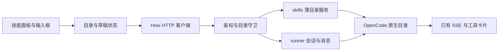

# Hoxi Skills 开发规范与实施方案

> 文档版本：0.2 · 日期：2026-10-20 · 状态：基于 OpenCode 1.19.3 本地探测的待实现方案。
> 优先实现 OpenCode 原生技能的目录展示、选择请求和调用反馈，再逐个适配其他运行时。
> 标准格式、实际观测和新增设计分别标注；文档存在不代表功能已经交付。

## 1. 实际基线与开发决策

### 1.1 版本与证据范围

本地检查确认以下两个二进制均为 `1.19.3`：

- `/Applications/Hoxi.app/Contents/MacOS/opencode`。
- `/opt/homebrew/bin/opencode`。

本次使用 Hoxi.app 内置二进制启动独立 `opencode serve`，在临时 Git 仓库和独立 data/config/cache/state 目录下探测，启用 pure 模式，不读取用户真实技能源，不调用模型。临时服务在结束后停止。

[本地探测证据](evidence/opencode-1.19.3-skills.json)保存响应结构与测试结果。它验证已安装二进制的隔离实例，不代表读取了正在运行的 Hoxi 守护进程配置，也没有完成真实模型调用或 UI 验收。生产接入仍需记录实际解析到的二进制路径、`--version` 和健康检查版本。

### 1.2 已经存在的 OpenCode 能力

| 实际观测 | 开发决策 |
| --- | --- |
| `GET /skill?directory=...` 返回技能数组，含 `name`、可选 `description`、`location`、`content` | OpenCode 目录以该接口为事实来源，Hoxi 不先重写同一套发现与加载器 |
| `GET /command?directory=...` 中已有 `source: "skill"` 条目 | 现有 `/` 补全可能已显示技能；补充来源类型、分组和调用语义 |
| 存在 `location: "<built-in>"` 的内置技能 | 详情支持内存内容，不把所有 location 当成文件路径打开 |
| `.opencode/skills`、`.agents/skills`、`.claude/skills` 以及独立全局目录中的测试技能被发现 | 复用引擎实际目录，不以文档中的扫描规则另建不同结果 |
| 切换 `directory` 后，两个测试项目各自的项目技能分离 | Hoxi 的请求和缓存必须继续按有效目录隔离 |
| 新增文件后重复 GET 未出现新技能；对该测试实例 dispose 后才出现 | 区分“刷新列表”和“重新加载引擎目录”，不能承诺重新 GET 就重新扫描 |
| 元数据中 `opencode/slash: "false"` 的测试技能仍出现在命令列表 | 不把网站描述的元数据开关直接当作 1.19.3 已验证能力；自动触发效果未实测 |

该版本 `/doc` 同时有 legacy `/skill` 和 V2 `/api/skill`，二者响应契约不同。Hoxi 当前发送、事件和会话适配使用 legacy 契约，第一版沿用该套契约；不因同一二进制提供 V2 就混接两套 API。

### 1.3 对原方案的收敛

第一版交付以下能力：

1. 通过 Hoxi 自有薄接口读取 OpenCode 实际目录和正文，展示来源、权限提示和内置技能。
2. 在输入框选择一个技能，向原生运行时发出明确的加载请求；保留排队、失败恢复和会话隔离。
3. 复用原生 `skill` 工具事件与现有 ToolCard，确认实际加载结果。
4. 明确缓存与刷新限制，保持已有安全审批、Stop 和历史读取行为。

以下内容放到后续阶段：其他 CLI 适配、确定性的原生命令调用、技能创建编辑、导入与安装、全包版本快照、跨运行时统一加载状态、远程市场和同步。

第一版不把完整内容摘要、全包复制、新 activation SSE 和独立历史账本作为前置条件。后续有复现需求时再增加，不能把普通内容摘要包装成已经锁定了引擎运行版本。

## 2. 标准 SKILL.md 编写约定

### 2.1 文件格式

采用 [Agent Skills 标准](https://agentskills.io/specification)。一个技能目录至少包含 `SKILL.md`，文件由 YAML frontmatter 和 Markdown 正文组成。

| 字段 | 标准约束 |
| --- | --- |
| `name` | 必填；1–64 字符；小写字母、数字和单连字符；与目录名一致 |
| `description` | 必填；1–1024 字符；说明用途和触发场景 |
| `license` | 可选；许可证名称或随包许可证文件引用 |
| `compatibility` | 可选；1–500 字符；描述环境要求 |
| `metadata` | 可选；字符串到字符串的映射 |
| `allowed-tools` | 可选、实验性字段；不同运行时的解释可能不同 |

`name` 不允许首尾连字符或连续 `--`。Hoxi 的标准作者校验采用 ASCII 可移植命名；外部扩展格式保留原文并单独报告兼容性。

### 2.2 推荐目录与完整示例

以下为 Hoxi 原创示例，可保存为 `<技能根目录>/review-changes/SKILL.md`：

```text
review-changes/
├── SKILL.md
├── references/
│   └── review-checklist.md
└── assets/
    └── finding-template.md
```

````markdown
---
name: review-changes
description: 审查当前代码改动，定位可复现的缺陷与缺失验证。用户请求代码审查、检查提交内容或分析回归风险时使用。
compatibility: 需要能够读取当前 Git 工作区、差异和项目验证命令。
metadata:
  author: "Hoxi"
  version: "1.0.0"
---

# 审查当前改动

## 输入

- 用户指定的审查范围；未指定时检查当前未提交差异。
- 当前工作目录中的工程规则和验证命令。

## 步骤

1. 阅读当前目录适用的工程规则，确认审查范围。
2. 读取 Git 状态和差异；沿调用链检查改动的影响。
3. 按需读取 [检查表](references/review-checklist.md)。
4. 优先检查正确性、隔离、异步竞态、错误处理和资源清理。
5. 使用已有测试或最小复现验证重要发现，记录证据与验证限制。
6. 按 [发现模板](assets/finding-template.md) 输出结果。

## 输出

- 每条发现包含触发条件、影响、文件位置和修复建议。
- 区分已经验证的缺陷与待确认的推断。
- 没有发现问题时说明审查范围和验证情况。

## 边界

- 此技能默认执行审查；修改代码、提交或发布遵循用户本轮授权。
- 保留当前工作区中已有的改动。
- 缺少必要依赖时报告原因，不自动安装依赖。
````

`references/review-checklist.md` 示例：

```markdown
# 检查表

- 读取和写入是否绑定当前会话、目录和请求世代？
- 错误是否有明确反馈，资源是否在完成或中止后释放？
- 修改是否影响原有调用方、持久化格式和权限行为？
- 结论是否有复现步骤、测试结果或清楚标注的推断？
```

`assets/finding-template.md` 示例：

```markdown
- 问题与优先级：
- 文件位置：
- 触发条件与复现步骤：
- 实际影响：
- 验证证据与限制：
- 修复建议：
```

提交技能包前必须确保引用实际存在。需要脚本时放入 `scripts/`，声明参数、依赖、输出和失败行为。

### 2.3 作者规则与扩展边界

- 正文推荐写清输入、步骤、输出和边界；这是 Hoxi 作者约定，标准不强制正文标题。
- 使用技能根目录下的相对资源路径，避免绑定个人机器的绝对路径。
- 说明“何时使用”比堆积泛化指令更重要；长资料移入引用文件，正文建议少于 500 行。
- `version` 在示例中是自定义元数据，不替代实际内容摘要。
- Hoxi 配置保存在独立状态中；共享文件的自定义标记使用 `metadata` 命名空间，不发明必填顶层字段。
- Claude 专属字段、动态命令、变量替换和子代理设置须由对应适配器识别；不在通用模式下猜测执行。

Claude Code 的扩展能力和标准字段需要分开处理，参见 [官方兼容说明](https://code.claude.com/docs/en/skills#using-skill-frontmatter-outside-claude-code)。

### 2.4 Hoxi 默认技能

- 内置默认技能随应用发布，引擎启动前由 `skills.SeedDefaults` 播种到 `~/.hoxi/skills/<name>/SKILL.md`；已存在的文件不覆盖，用户修改优先。
- `ensureHoxiModelsConfig` 在生成 `OPENCODE_CONFIG` 时把该目录并入 `skills`。合并按路径并集处理，兼容数组与 `{paths, urls}` 两种既有形式，统一输出数组形式（官方 schema 已把对象形式标记为 deprecated），不覆盖用户自定义来源。
- 该目录同时登记在 `internal/skills/userSkillRoots`，Hoxi 技能面板将其标识为 `~/.hoxi/skills` 来源并允许打开文件。
- 默认技能源文件位于 `internal/skills/defaults/`；仓库根 `.opencode/skills/` 的副本用于本项目会话，测试会校验两者一致。

## 3. OpenCode 1.19.3 协议与语义

### 3.1 实际目录响应

下列类型按本地 `/doc` 和响应整理，属于实际上游结构：

```ts
interface OpenCodeSkillInfo {
  name: string;
  description?: string;
  location: string;
  content: string;
}

interface OpenCodeCommandInfo {
  name: string;
  description?: string;
  agent?: string;
  model?: string;
  source?: "command" | "mcp" | "skill";
  template: string;
  subtask?: boolean;
  hints: string[];
}
```

上游列表会带正文，Hoxi 适配层可在内存保留，向前端列表只返回摘要，详情按需返回正文。不能假定上游另有 `GET /skill/{name}` 详情接口；本次导出的 legacy OpenAPI 中只有 `GET /skill`。

Hoxi 当前 `SlashCommandInfo` 只有名称、说明和 agent，需要补充 `source`、`hints` 等所需字段。`composer-autocomplete.ts` 目前选择后只插入文本；这与调用原生 command API 的语义不同，不能把它标为“命令已经执行”。

### 3.2 两种原生使用方式

| 方式 | 原生行为 | Hoxi 接入策略 |
| --- | --- | --- |
| 模型调用 `skill` 工具 | 运行时按名称加载技能，返回正文与资源根信息 | 首版优先使用；前端必须等待实际工具结果确认 |
| `POST /session/{id}/command` | 运行时把命令/技能模板展开后执行本轮 | 后续接入，先验证命令预处理门控和 Hoxi 会话生命周期 |

固定版本的 [skill 工具源码](https://github.com/anomalyco/opencode/blob/v1.19.3/packages/opencode/src/tool/skill.ts)显示，参数为 `{name}`，加载前检查 `skill` 权限，结果 metadata 含 `name`、`dir`。此处为源码核对，本次未通过模型实际触发工具。

固定版本的 [command 注册源码](https://github.com/anomalyco/opencode/blob/v1.19.3/packages/opencode/src/command/index.ts)显示，技能可以映射成 `source: "skill"` 的命令，模板带技能根信息；已有同名命令时会优先占用名称。Hoxi 按接口返回的有效条目工作，不承诺可以通过原生按名称调用任意被覆盖的磁盘副本。

### 3.3 原生命令接口只作为后续参考

本地 OpenAPI 中 command 请求的 `command` 和 `arguments` 必填；`model` 为 `provider/model` 字符串，与普通 prompt 的模型对象不同。下例是上游格式示例，不是 Hoxi 已实现的接口：

```json
{
  "command": "review-changes",
  "arguments": "关注会话隔离和异步读取",
  "agent": "build",
  "model": "provider-id/model-id",
  "variant": "high"
}
```

command 还接受 `messageID` 和文件 `parts`，但不接受普通 prompt 的 `system` 字段。实现时必须验证 Hoxi 的系统提示、工作区上下文、模型选择、用户消息记录和附件是否保持正确，不能直接替换 URL 后照搬原请求体。

[1.19.3 的 command 预处理源码](https://github.com/anomalyco/opencode/blob/v1.19.3/packages/opencode/src/session/prompt.ts)包含模板变量替换与动态 Shell 展开。后者在普通模型工具循环前发生，不能假设现有工具审批 Hook 会覆盖它；本次未执行该路径。完成门控验证前，Hoxi 首版显式技能选择继续使用原生 skill 工具请求方式。

## 4. 第一版架构与代码归属



| 职责 | 位置与边界 |
| --- | --- |
| 目录 HTTP 接口、OpenCode 结果转换、缓存 | `internal/skills/`，核心类型为 `Service`；不先增加独立技能执行器 |
| 统一会话内的技能请求、输入组装、事件转译 | `internal/runner/`，OpenCode 逻辑归对应运行时文件 |
| 服务注册、会话上下文与 transport 注入、来源检查 | `internal/gateway/` |
| HTTP 客户端与协议类型 | `web/src/services/skills.ts`、`skills-types.ts` |
| 目录缓存、技能选择、排队和失败恢复 | `web/src/store/skills.ts` 及现有会话模块；在 `workspace.ts` 扁平导出 |
| 技能面板与详情 | `web/src/components/skills/` |
| 输入框和原生调用状态 | `web/src/components/timeline/` |
| 双语文案 | `web/src/i18n/locales/{en-US,zh-CN}/skills.ts` |

`skills` 服务通过注入的运行时目录接口读取数据，不反向依赖 `runner`、`gateway`、`app` 或 `cli`。共享长生命周期 HTTP transport、Basic Auth 和目录参数；禁止每次请求另建连接池或改写 OpenCode 源码。

## 5. 目录适配与最小接口

### 5.1 Hoxi 描述符

以下类型为新增 Hoxi 设计，与上游实际结构分开维护：

```ts
interface SkillDescriptor {
  key: string;
  name: string;
  description?: string;
  runtime: "opencode";
  source: "builtin" | "project" | "user" | "external";
  sourceLabel: string;
  canOpenLocation: boolean;
  contentDigest?: string;
}

interface SkillSelection {
  key: string;
  name: string;
}
```

`key` 是后端按运行时、有效目录和已解析来源生成的不透明标识；不接受前端传入绝对路径替代来源检查。`contentDigest` 若提供，仅表示本次读取到的正文摘要，不覆盖整个资源包，也不承诺锁定运行时版本。

目录与详情缓存键必须包含运行时、版本和有效 `directory`；会话缓存还包含 `sessionID`。原生目录按名称解析后的条目是可调用候选，不另行发现并显示原生引擎无法按名称选择的同名副本。

### 5.2 HTTP 路由草案

| 方法与路径 | 上下文与参数 | 结果 |
| --- | --- | --- |
| `GET /api/hoxi/skills/list` | `directory`；有会话时附 `sessionID` | 原生有效技能描述符列表 |
| `GET /api/hoxi/skills/detail` | 同一上下文及 `key` | 描述符与从上游目录记录取得的正文 |

这两个路径是新增设计。由技能领域包 `RegisterRoutes(mux)` 注册，复用网关鉴权与目录守卫；后端按会话真实运行时决定适配器，不信任客户端随意声明 runtime。

无会话预览只允许已登记工作区。新会话沙箱建立后重新读取该沙箱目录，并更新选择的 key；名称消失、有效来源变化或发生目录冲突时保留草稿、提示重新选择。

其他 CLI 尚未完成适配时返回明确的“当前运行时未支持”，不能回退展示 OpenCode 目录并让用户误以为也能在该 CLI 调用。

### 5.3 内置技能、资源与路径

`location: "<built-in>"` 没有可打开的文件目录；详情直接显示上游 `content`。磁盘来源只有在路径经过真实路径与授权根校验后，才提供本地打开入口。

原生使用期间资源根由 OpenCode 提供；首版不把技能包重新复制到另一套 Hoxi 目录。若未来提供资源 HTTP 预览，要单独定义相对路径检查、链接边界、有界读取和二进制展示，不接受任意绝对路径。

技能正文和目录记录不进入普通诊断日志。个人路径仅在当前已授权上下文展示，远程界面遵守对应节点和工作区权限。

## 6. 输入框与统一发送链路

### 6.1 首版交互

- `/` 建议按技能、普通命令、MCP 提示分组；分类来自 `source`，不能靠名称猜测。
- 选择技能后形成独立标签，保留当前任务正文。首版每条消息只选择一个技能，后续再增加组合调用。
- 标签表示用户意图，不代表已加载；实际加载依靠第 7 节的原生事件。
- 不改写或安装用户技能文件；列表与查看功能不执行技能正文。

### 6.2 prompt 扩展草案

继续通过统一入口发送；以下字段是 Hoxi 自有扩展，当前尚未实现：

```http
POST /api/hoxi/sessions/ses_example/prompt_async?directory=%2Frepo%2F.hoxi%2Fworktrees%2Fses_example
Content-Type: application/json
```

```json
{
  "agent": "build",
  "parts": [{ "type": "text", "text": "请审查这次改动" }],
  "skillSelection": {
    "key": "skl_example",
    "name": "review-changes"
  }
}
```

后端按以下顺序执行：

1. 沿用隐私授权、会话所有权、有效目录和并发运行检查。
2. 在最终会话目录查询 OpenCode 当前记录，校验 key 与 name 对应；不把 key 当成文件路径。
3. 保留用户原文与选择记录，构造一段明确要求使用该名称原生技能的本轮用户指令，参数仍是普通文本。
4. 复用现有 `startOpenCodeTurn` 的模型、系统上下文、附件、SSE、Stop 和持久化流程。
5. 向上游只发送其实际支持的 prompt 字段，剥离 `skillSelection`；不内联整个技能正文来假装原生调用。
6. 模型若没有调用 skill 工具，结束时显示“本轮未确认加载”，不报告技能调用成功。

因此首版提供的是“请求使用原生技能”，并不保证强制预加载。产品若要求完全确定的模板展开，应推进第 3.3 节的 command 接入和门控验收。

旧 OpenCode 会话收到扩展时先走既有收编流程进入 runner，不能让未知字段直接经透传路由到上游。当前 runner 没有 `command` 子路由；未来使用 command 时也必须新增统一 `/api/hoxi/sessions/{id}/command` 的处理，禁止前端直调上游 `/session`。

### 6.3 草稿、排队与历史

选择状态与文本、附件一起进入草稿、队列、编辑恢复和失败重试。出队时重新校验最终目录与有效技能来源，变化后暂停该条并提示，不静默换技能或丢弃标签继续发送。

用户选择可存入用户文本片段的 Hoxi 专属 metadata。Go 的 `MessagePart` 已有 metadata 字段，前端对应类型、乐观消息和历史合并需补齐；向上游组装 parts 时剥离私有 metadata。纯技能发送也要构造明确任务请求，不能因原文为空而丢弃选择。

同一次发送只走一个入口，不同时发普通 prompt 和 command。请求重试继续遵循会话发送状态；结果不明时先刷新历史，不自动再开一轮。

## 7. 使用现有事件表达真实状态

首版继续只订阅 `/api/hoxi/event?directory=...`，复用原生 `message.part.updated` 和已有工具卡片，不新增技能专用 SSE 或独立 activation 历史账本。

| 界面状态 | 证据 |
| --- | --- |
| 已选择 | 本地草稿标签 |
| 已提交技能请求 | Hoxi 接收用户消息与技能选择 |
| 正在加载 | 该执行周期出现匹配名称的 `tool: "skill"` pending/running 片段 |
| 已加载 | 同一工具片段 completed，输入和结果指向所选技能 |
| 加载失败 | 对应工具片段 error |
| 本轮未确认加载 | 本轮结束，没有成功的匹配技能调用 |

模型的口头声明、选择标签和普通文件读取不能替代原生调用证据。原生 skill 工具 completed 表示加载工具完成，不表示整个用户任务完成。

`State.Input.name` 和 `State.Metadata.name/dir` 按适配器实际事件验证后使用；内置技能不要求 dir 是磁盘路径。当前 `relayOpenCodeEvent` 已转译 message part 并保留工具状态，可在这一链路补充匹配逻辑。真实字段仍需在一次授权的模型调用中采集并验证。

历史直接复用现有 turns 存储。重连补齐、四态耗时、运行中止和高频 requestAnimationFrame 合并保持既有行为；切换运行时后，历史工具卡片只代表原来那次执行。

后续如需跨运行时统一技能状态，再单独增加有证据的派生事件和存储，并说明它与原生 ToolCard 的关系。

## 8. 引擎缓存、刷新与 Worktree

### 8.1 已验证的缓存限制

本次隔离实例中新增 `hoxi-probe-late/SKILL.md` 后，重复 GET 没有发现它；`POST /instance/dispose?directory=...` 返回 true，重新读取才出现。该结果仅证明这次 1.19.3 测试的行为，不能直接把 dispose 当成生产环境通用刷新按钮。

首版“刷新列表”只更新 Hoxi 从引擎读取的结果，不承诺引擎重新扫描磁盘。需要重载时明确显示“技能目录可能需要重新加载工作区”。

新增安全重载功能前必须：

- 检查共享该 OpenCode directory 的全部运行会话、待审批和上游连接，而非只看当前激活会话。
- 运行中不自动 dispose；提供明确的等待状态。
- 使用受控的目录级重载，处理 SSE 重新连接与目录缓存失效。
- 避免调用全局 dispose 来刷新单个技能，也不把重载等同于创建一个新 Hoxi 会话。

### 8.2 生命周期要求

| 场景 | 必须保持的行为 |
| --- | --- |
| 新建沙箱 | 以最终 Worktree 读取技能；主工作区预览结果重新校验 |
| 切换会话/目录 | 按会话和递增请求世代丢弃过期响应 |
| 未提交项目技能 | 新 Worktree 可能没有该文件；不得悄悄读取另一会话或主目录副本 |
| 同名技能 | 显示引擎实际解析来源；不承诺原生按名称调用任意磁盘副本 |
| 版本变化 | 列表内容不代表已锁定执行版本；需要精确复现时另做引擎一致的快照方案 |
| Steer | 仅沿用已支持的运行中输入；技能加载状态按实际工具事件判断 |
| runtime 切换 | 清空当前目录能力缓存并重校验选择；不把 OpenCode 技能加载状态继承给其他 CLI |
| Fork/Revert | 保持既有消息历史语义；继承的历史卡片不等于新进程已加载 |

## 9. 权限、隐藏与扩展语义

技能读取和预览不执行脚本、安装命令或动态模板。技能实际调用继续经过原生 `skill` 权限检查；后续 Shell 操作复用 Hoxi 的权限插件和多运行时 Hook，通过统一 `/api/hoxi/permission?directory=...` 展示审批。

Hoxi 不把“选择了技能”转成永久工具授权。`allowed-tools`、hooks 和动态命令的语义逐运行时处理；原生命令预处理可能越过普通工具循环的问题按第 3.3 节先验证，不能只靠提示词宣布已门控。

上游 `/skill` 返回目录记录不一定等于当前 agent 获准调用的集合。列表可展示发现结果，但“可调用”需结合当前 agent 的有效权限；没有可靠权限判定时显示权限待确认，并以原生拒绝结果为准，不承诺一定可用。

OpenCode 的原生技能权限配置和工具禁用机制可优先复用，参考 [官方技能权限说明](https://opencode.ai/docs/skills/)。写入配置必须保留用户已有规则、采用明确作用域、原子持久化并验证重载行为。首版暂不提供统一“禁止所有运行时使用”的开关。

“从 Hoxi 列表隐藏”仅控制界面，不能宣称阻止原生模型自动加载。远程技能 URL、自动下载安装不是本次交付范围。

技能内容作为模型上下文随用户发起的 AI 请求发送到其自行配置的提供商。后续若增加后台技能生成或审计，必须在 UI 中明确说明目的地，不能在扫描时静默调用模型。

## 10. 其他运行时与后续能力

| 能力 | 演进方式 |
| --- | --- |
| Claude Code | 按 Hoxi 实际 `-p` / stream-json 参数实测原生发现、加载、资源和事件；保留其专属扩展 |
| Antigravity / Qoder / CodeBuddy | 分别验证，未完成前标记未支持；消息外形相同不等于技能机制相同 |
| 通用 inline 模式 | 作为明确兼容子集另立方案，说明不支持的动态命令、hooks 和变量；不静默替代原生调用 |
| 精确版本复现 | 同时解决引擎目录缓存、正文与资源包快照、同名解析和运行时可达路径 |
| 创建/编辑/导入 | 增加作者格式校验、版本冲突写入、来源边界和引擎安全重载 |
| 移动端 | 复用节点端目录与选择协议，手机不扫描桌面文件系统；GoPanel 未提供契约时隐藏入口 |

通用模式将来若需复制包资源，目录包含会话 ID，避免 local 模式的共享工作区串资源；持久状态依赖既有 Store 路径并支持 `HOXI_SESSION_STORE_DIR`。这些后续设计不作为 OpenCode 首版的前置重构。

## 11. 实施阶段与验收

| 阶段 | 交付 | 完成标准 |
| --- | --- | --- |
| M0 实际契约 | 已完成隔离二进制/OpenAPI/目录/命令/缓存探测；补生产配置与真实调用验证 | 明确已测与未测项，不把网站最新版当成本地契约 |
| M1 目录和详情 | Hoxi 薄接口、OpenCode 结果适配、列表与详情、`/` 来源分组 | 项目/个人/内置技能正确显示，坏状态有反馈，目录切换不串数据 |
| M2 原生技能请求 | 单技能选择、prompt 扩展、旧会话收编、队列与失败恢复、原生卡片反馈 | 一次真实模型调用验证加载、资源、审批、Stop 与重连历史 |
| M3 原生命令 | 统一 command 分发、模板预处理门控、上下文保持 | 明确命令源、附件和模型格式，安全门控覆盖预处理与实际工具调用 |
| M4 其他运行时与管理 | 各 CLI 适配、创建编辑、导入、版本复现和移动端 | 按能力逐项验收，不宣称所有引擎等价支持 |

### 11.1 自动化测试重点

- 列表适配保留可选 description、内置 location 和 command source，列表接口不把全部正文发给前端。
- sessionID、directory、来源 key 和运行时不匹配时拒绝，不暴露任意文件内容。
- 支持文字、图片与单技能组合，以及纯技能消息；入队、编辑、失败恢复不丢选择。
- 上游未知的 `skillSelection` 被消费，不透传；旧 OpenCode 会话收编后仍走目录和隐私守卫。
- 模型未调用 skill、调用错误名称、工具失败时不显示“所选技能已加载”。
- 乱序事件、切会话过期响应、断线重连、重启历史、Stop 和权限拒绝保持现有语义。
- 不在运行中的共享目录上自动 dispose，不为刷新一个技能调用全局 dispose。

### 11.2 真实运行时验收

本次已完成的探测没有模型调用，不能替代本项。使用临时仓库和测试来源，在开发会话已有授权范围内调用轻量模型，不在常规单测中使用用户账户额度。

构造唯一名称的技能，正文指向测试资源，资源含当轮随机标记。验证原生 skill 工具完成、资源可读、权限拒绝与 Stop、重连和历史显示；采集脱敏事件样例。标记输出用于行为验证，原生工具事件用于界面状态证据。

command 路径另测参数替换、文件 parts、系统上下文、同名命令占用、动态命令审批和重试。没有完成本项前，接口存在不等于 Hoxi 可以安全开放完整原生命令语义。

### 11.3 工程门禁

代码实现后按 `AGENTS.md` 完成：

```bash
npm --prefix web run lint && npm --prefix web test && npm --prefix web run build
go vet ./... && go test ./... && go build ./...
```

涉及移动端追加：

```bash
flutter analyze client && (cd client && flutter test)
```

UI 使用 `t("skills.camelCaseKey")`，保持中英文键和插值对齐。遵守 SolidJS 响应式访问、生命周期清理、源码 800 行门禁和 `components → store → services` 边界。

本文修订仅修改文档与探测证据，不宣称已经通过上述功能或构建验收。

## 12. 参考与证据优先级

证据优先级：实际运行版本的行为与 `/doc` → 对应版本源码 → 当前官网说明 → Hoxi 设计推断。升级 OpenCode 后应重新导出契约并运行目录、命令和缓存回归；版本号只是定位，不能替代行为验证。

- [OpenCode 1.19.3 本地隔离探测记录](evidence/opencode-1.19.3-skills.json)
- [Agent Skills 格式标准](https://agentskills.io/specification)
- [OpenCode 服务与 OpenAPI](https://opencode.ai/docs/server/)
- [OpenCode 1.19.3 技能实现](https://github.com/anomalyco/opencode/blob/v1.19.3/packages/opencode/src/skill/index.ts)
- [工程规则](../AGENTS.md)
- [架构与协议](../DEVELOPMENT.md)
- [会话所有权背景](handoff/2026-10-19-session-ownership.md)（历史记录，当前实现以代码为准）
- [跨 CLI 会话接管与桥接](../HANDOFF_AND_CLI_BRIDGE.md)
- [Claude Code 审批 Hook](claude-code-approval-hook.md)
- [Antigravity 审批 Hook](antigravity-approval-hook.md)
